# Planelands · 航天飞机自主返场：SCP + MPC 制导的教学型仿真

[](LICENSE)

> 在线仿真：<https://spaceshuttle.ftmine.cn>
>
> 6-DOF、飞控和 SCP/MPC 制导都在浏览器里跑，不用装任何东西。
> 用桌面版 Chrome 或 Edge（需要 WebGL2）。首次加载约 35 MB，之后走缓存。
## 致谢

本项目在 [LINUX DO](https://linux.do) 社区分享推广，感谢社区和各位佬友的支持与反馈。

把一架航天飞机（Orbiter 级，无动力）随机放在天空里的任意位置：高度 8–25 km、速度最高 Mach 2.6、机头朝向随意。
它自己选跑道、定航路、管理能量，然后对准、拉平、接地、放减速伞、刹车，停在跑道上，全程没有人工干预。

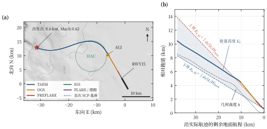

**图 1**　一次完整的自主返场（种子 1000，无风）：出生在跑道西偏北 34 km、高度 8.6 km、Mach 0.62，
238 s 后在 RWY15 入口后 560 m 接地，下沉率 0.81 m/s。(a) 地面航迹叠加地形晕渲，颜色表示飞行阶段，绿色虚线圆是 HAC；
(b) 能量高度 $`E_h`$ 随剩余航程的变化。阴影带按实际航迹和当地 Mach 数积分得到：下界全程以 $`(L/D)_\text{max}`$ 飞，
上界全程以 $`(L/D)_\text{min}`$ 飞（第 0 课的能量带）。

这个仓库可以当讲义读，也可以当仿真器用：

- **讲义**：占了 README 的大半。从滑翔机的能量账讲起，推导序列凸优化（SCP）轨迹规划和模型预测控制（MPC）跟踪，
  最后是 Orbiter 式的进近拉平律。公式都能在 `sim/gnc/` 里找到对应代码，参数也是从代码里取的。
- **仿真器**：6-DOF 分片气动、电传飞控、起落架、Dryden 湍流，three.js 渲染的地形、体积云、雷暴，
  还有 MEDS 玻璃座舱和 HUD。也可以不要服务器，整个跑在浏览器里（Pyodide）。

> 本项目与 NASA 及任何航天机构无关。机体几何、气动和航电都是根据公开资料重新建模的近似，不是真实飞行数据。

---

## 目录

- [快速开始](#快速开始)
- [讲义](#讲义)
  - [第 0 课 无动力着陆](#第-0-课-无动力着陆)
  - [第 1 课 规划模型：3-DOF 质点 + 配平气动表](#第-1-课-规划模型3-dof-质点--配平气动表)
  - [第 2 课 能量管理与航迹几何](#第-2-课-能量管理与航迹几何)
  - [第 3 课 序列凸优化（SCP）](#第-3-课-序列凸优化scp)
  - [第 4 课 模型预测控制（MPC）](#第-4-课-模型预测控制mpc)
  - [第 5 课 进近与着陆：Orbiter 式剖面和拉平律](#第-5-课-进近与着陆orbiter-式剖面和拉平律)
  - [第 6 课 降级模式](#第-6-课-降级模式)
  - [第 7 课 电传飞控](#第-7-课-电传飞控)
  - [课后思考题](#课后思考题)
- [仿真的逼真程度](#仿真的逼真程度)
- [测试与结果](#测试与结果)
- [代码结构](#代码结构)
- [已知限制](#已知限制)
- [参考文献](#参考文献)
- [许可证](#许可证)

---

## 快速开始

### 本地运行（Python 后端）

```bash
pip install -r requirements.txt        # numpy, scipy, websockets, cvxpy (+ CLARABEL / ECOS), osqp
python server.py                       # http://localhost:8000   (WebSocket: 8765)
```

用 Chrome 或 Edge 打开 `http://localhost:8000`（需要 WebGL2，最好有独立显卡）。
首次启动会生成世界数据（约 1 分钟，缓存到 `web/data/`）和配平表（约 6 秒，缓存到 `sim/data/`）。

| 参数 | 说明 |
|---|---|
| `--guidance scp_mpc\|hold_glide` | 制导律。默认 `scp_mpc`；`hold_glide` 是机翼水平滑翔的占位制导，用来对比 |
| `--spawn feasible\|any` | 出生点。默认 `feasible`，只在能飞回跑道的能量带内随机出生；`any` 完全随机 |
| `--seed N` | 固定随机出生点 |
| `--http-port` / `--ws-port` | 端口 |

后端没有启动时，网页会自动进入“本地预览”模式。这个模式只有运动学，没有气动，用来单独调画面。

### 浏览器版

浏览器版没有后端进程，服务器只提供静态文件。同一套 Python 仿真代码（6-DOF、飞控、SCP/MPC）通过
[Pyodide](https://pyodide.org)（WebAssembly 版 CPython）在两个 Web Worker 里运行：

- `web/js/sim/sim_worker.js`：仿真主循环，60 Hz，对应 `server.py`；
- `web/js/sim/plan_worker.js`：SCP 规划，对应服务器版的规划进程。

Worker 和页面之间的 JSON 消息与 WebSocket 版完全相同，页面通过 `core/local_sim.js` 把 Worker 当成一个 socket 使用。

```bash
python server.py  →  http://localhost:8000/?sim=browser    # 开发：不构建，直接在浏览器里跑仿真（Pyodide 走 CDN）
python tools/build_web.py --serve 8090                     # 构建 dist/ 并在本机预览 http://localhost:8090
python tools/deploy_web.py <ssh-host> [--dry-run]          # 构建并经 ssh + tar 发布到 <host>:/var/www/planelands
                                                           # （tools/deploy_web.sh / .cmd 是它的启动脚本；nginx 配置在 deploy/）
```

<details>
<summary>浏览器版的缓存、体积和性能细节</summary>

- **缓存**：每次发布是一个以内容哈希命名的目录 `v/<ver>/`；大数据按内容寻址放在 `d/<sha>/`；Pyodide 自托管在 `pyodide/<版本>/`。
  这三类都设成 `immutable` 长期缓存，只有 `index.html` 和 `version.json` 每次访问都会重新验证。已打开的页面每 5 分钟检查一次新版本。
  发布时只上传有变化的文件，最后才切换 `index.html`，保留最近 5 个版本。
- **体积**：首次访问约下载 35 MB。其中地形和天气数据约 10 MB（高程图用平面预测 + 字节分组无损编码，13.3 MB 压到 7.4 MB），
  Pyodide 加 numpy/scipy/cvxpy/clarabel 约 25 MB。体积云的 3D 噪声在页面的 Worker 里生成，不下载。
- **性能**：WebAssembly 里的 Python 比原生慢约 3 倍。仿真每 tick 约 11 ms（预算 16.7 ms），一次 SCP 规划约 1–3 s，在独立 Worker 中运行。
  CPU 跟不上时仿真时间会变慢，但不会丢步。
- **与原生的差异**：Pyodide 里没有 OSQP，MPC 改用 Clarabel 解同一个 QP，结果相差小于 5e-4。
  cvxpy 默认的 COO 规范化后端在 wasm32 上会因 int64→int32 转换出错，所以改用 SciPy 后端。
</details>

<details>
<summary>在线演示的部署（HTTPS、访问统计）</summary>

- **访问路径**：`spaceshuttle.ftmine.cn` 走 Cloudflare 代理（SSL 模式 Full strict）→ 服务器 443 端口的 xray（REALITY，
  非代理流量原样转给 `127.0.0.1:8444`，带 PROXY protocol）→ nginx。证书用 Cloudflare Origin CA 的 `*.ftmine.cn`。
  旧地址 `http://<服务器>:8090/` 和域名的 http 都 301 跳到 `https://spaceshuttle.ftmine.cn`。
  配置在 `deploy/nginx-planelands.conf`（装到 `/etc/nginx/sites-available/planelands.conf`）和
  `deploy/planelands-site.conf`（装到 `/etc/nginx/snippets/`）。
- **访客 IP**：经 Cloudflare 时 TCP 对端是 Cloudflare 节点，真实地址取 `CF-Connecting-IP`，只在对端确实是 Cloudflare 网段时才信任。
  访问日志 `/var/log/nginx/planelands.access.log` 记录访客 IP、请求、状态、User-Agent 和国家/地区（`CF-IPCountry`）。
- **每天的访问量**：`deploy/planelands-visits.py`（装成 `/usr/local/bin/planelands-visits`）读当前和轮转的访问日志，
  按北京时间每天一行写进 `/var/log/planelands/visits.tsv`：访客数（不同的 IP + 浏览器）、IP 数、打开次数（页面本身的加载，
  不算资源文件和每 5 分钟的版本检查）、主要国家/地区。爬虫、脚本和无头浏览器不计。
  `deploy/planelands-visits.cron` 装到 `/etc/cron.d/`，每小时更新一次；nginx 日志只留 14 天，更早的天数保留在这个文件里。
  查看：`ssh <host> planelands-visits`（默认最近 30 天，`--days N`）。
</details>

### 操作

| 操作 | 按键 / 鼠标 |
|---|---|
| 视角：追随 / 驾驶舱 / 塔台 / 跑道旁 / 飞掠 / 自由 / 俯瞰 | `1`–`7`，或底部按钮 |
| 环视 / 缩放 | 鼠标拖动 / 滚轮（塔台、跑道旁视角滚轮是变焦） |
| 暂停、随机重新放置、隐藏界面 | `P`、`R`、`H` |
| 显示气流（表面压力 / 机翼剖面 / 尾涡） | `V`，或右侧面板“仿真”页 |
| 手动驾驶（CSS 操纵杆模式） | `W/S` 俯仰、`A/D` 滚转、`Q/E` 偏航、`Z/X` 减速板、`G` 起落架、`B` 刹车、`C` 减速伞 |
| 自由相机 | `WASD` + `Q/E` 升降，`Shift` 加速 |
| MEDS 显示器窗口：PFD / 导航 | `F` / `N` |

右侧面板可以调云、降水、雷暴、风和湍流、时间日期、曝光和画质。
“短五边演示”会把飞机直接放到 RWY33 入口前 1 km 的拉起圆弧末段，用来单独观察拉平、接地和滑跑。

---

# 讲义

> 第 0 课讲整体结构，建议先读，后面几课可以挑着看。
> 公式符号尽量和代码一致。每课开头注明源文件，正文括号里是函数名。

## 第 0 课 无动力着陆

### 0.1 能量高度

轨道器再入大气层后没有推力，能用的只有高度和速度。两者合成一个量，叫**能量高度**（单位质量机械能除以 $`g`$）：

```math
E_h \;=\; h + \frac{V^2}{2g}
```

对时间求导，代入质点动力学 $`\dot h = V\sin\gamma`$、$`\dot V = -D/m - g\sin\gamma`$（暂不计风）：

```math
\dot E_h \;=\; \dot h + \frac{V\dot V}{g} \;=\; V\sin\gamma + \frac{V}{g}\Big(-\frac{D}{m} - g\sin\gamma\Big) \;=\; -\frac{D\,V}{m g}
```

能量高度只减不增，减少的速率由阻力决定。再换成对地面距离 $`s`$ 的导数。
稳定滑翔时 $`\dot s = V\cos\gamma`$，$`L\cos\phi \approx mg\cos\gamma`$（$`\phi`$ 是倾侧角），于是

```math
\frac{dE_h}{ds} \;=\; -\frac{D}{mg\cos\gamma} \;\approx\; -\frac{1}{(L/D)\cos\phi}
```

即每飞 1 m 地面距离要花掉 $`1/(L/D)`$ m 能量高度，转弯时再除以 $`\cos\phi`$。
$`L/D`$ 可以在一定范围内调：以 $`(L/D)_\text{max}`$ 飞最省，航程最远；开减速板、加大迎角，
能把它压到 $`(L/D)_\text{min}`$，消耗最快。因此从当前状态飞到目标点（地面路径长 $`S`$），可用能量必须落在一个**能量带**里：

```math
\Delta E_\text{min} = \int_0^S \frac{ds}{(L/D)_\text{max}} \;\;\le\;\; \Delta E_\text{avail} = E_{h,0} - E_{h,f} \;\;\le\;\; \Delta E_\text{max} = \int_0^S \frac{ds}{(L/D)_\text{min}}
```

左边不成立，怎么飞都够不着跑道；右边不成立，减速板全开也耗不掉，只能绕路。没有发动机就没法复飞，只有一次机会。

> 思考：同样是能量过剩，为什么绕一圈比开减速板管用？
> 提示：亚声速时减速板只能把 $`L/D`$ 从 4.9 降到 2.9 左右（图 4b），航迹长度却可以翻倍。

### 0.2 分层结构

从 25 km 高空到停在跑道上约 5–10 分钟，对整段直接解一个 6-DOF 最优控制问题不现实。通常按时间尺度分层，每层只管自己那个尺度：

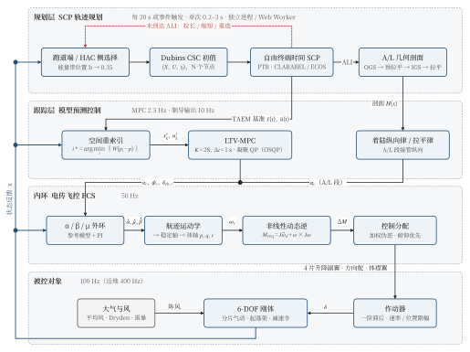

**图 2**　GNC 分层结构。各层的更新频率标在层名旁边；蓝线是状态反馈，红色虚线是 SCP 没到达 ALI 时的恢复路径（3.7 节）。
A/L 段的纵向指令由着陆律给出，和 MPC 的横向、减速板指令合并后送入飞控。

每一层都把下一层当成理想的执行机构：

- 规划层眼里的飞机是一个 3-DOF 质点，迎角和倾侧角可以直接设定，只受速率限制，力矩平衡交给飞控。
- MPC 在规划轨迹附近线性化，处理规划层没考虑的风、湍流和模型误差。
- 飞控把迎角、倾侧角指令换成舵面偏角。

后面几课按这个顺序从上往下讲。

### 0.3 飞行阶段

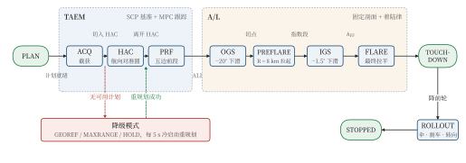

**图 3**　飞行阶段与切换条件。没有可用计划时进入降级模式（第 6 课），重规划成功后回到 TAEM。

- **TAEM**（Terminal Area Energy Management，末端区域能量管理）：从当前位置飞到**进近着陆界面 ALI**，同时把能量调到正好。
  这一段由 SCP 规划，由 MPC 跟踪。
- **A/L**（Approach and Landing，进近着陆）：从 ALI 开始沿固定的几何剖面下滑并拉平接地。这段剖面是事先算好的，不需要在线优化。

坐标约定：世界坐标是 ENU（东、北、天），单位 m。航向 $`\psi`$ 从正北顺时针量起。
每个跑道端有自己的跑道坐标系：$`x`$ 沿着陆方向，入口处 $`x=0`$；$`y`$ 指向着陆方向的右侧。

---

## 第 1 课 规划模型：3-DOF 质点 + 配平气动表

> 代码：`sim/gnc/model.py`

### 1.1 状态、控制与运动方程

规划用的模型故意做得比真实飞机简单。状态和控制分别是

```math
x = [\,E,\ N,\ h,\ V,\ \gamma,\ \psi\,]^\top, \qquad u = [\,\alpha,\ \phi,\ \delta_{sb}\,]^\top
```

其中 $`V`$ 是真空速，$`\gamma`$ 和 $`\psi`$ 是相对空气的航迹角和航向，$`\alpha`$ 是迎角（度），$`\phi`$ 是倾侧角（弧度），$`\delta_{sb}`$ 是减速板开度（0–98.6°）。
运动方程为

```math
\begin{aligned}
\dot E &= V\cos\gamma\sin\psi + w_E(h) \\
\dot N &= V\cos\gamma\cos\psi + w_N(h) \\
\dot h &= V\sin\gamma \\
\dot V &= -\frac{D}{m} - g(h)\sin\gamma \\
\dot\gamma &= \frac{L\cos\phi - m g(h)\cos\gamma}{mV} \\
\dot\psi &= \frac{L\sin\phi}{mV\cos\gamma}
\end{aligned}
\qquad
\begin{aligned}
L &= \bar q S\, C_L(\alpha, M, \delta_{sb}, \text{gear}) \\
D &= \bar q S\, C_D(\alpha, M, \delta_{sb}, \text{gear}) \\
\bar q &= \tfrac12\rho(h)V^2,\quad M = V/a(h) \\
g(h) &= g_0\big(R_E/(R_E+h)\big)^2
\end{aligned}
```

- 大气用 US1976 标准大气（0–86 km，向量化实现）。
- 风 $`w(h)`$ 是平均风廓线：500 m 以下按 1/7 次幂律，$`|w| = w_{10}\,(h_\text{AGL}/10)^{1/7}`$；再往上保持不变。
- 质量 $`m = 99.8`$ t，参考面积 $`S = 249.9\ \text{m}^2`$。

### 1.2 配平后的气动表

$`C_L`$ 和 $`C_D`$ 除了迎角，还取决于舵面偏角，而舵面偏多少由配平（俯仰力矩为零）决定。
规划模型如果直接用干净构型的系数，就漏掉了**配平阻力**，也就是升降副翼和体襟翼为配平而偏转带来的额外阻力。跨声速区这一项不小。

`sim/trim.py` 离线在网格

```math
\alpha \in [-4^\circ, 40^\circ]\ (\text{步长}\ 1^\circ) \;\times\; M \in \{0.2,\dots,3.0\}\ (21\ \text{点}) \;\times\; \delta_{sb}\in\{0,25,50,75,98.6\} \;\times\; \text{gear}\in\{0,1\}
```

的每个点上，用完整的分片气动模型求出 $`C_m = 0`$ 时的升降副翼和体襟翼偏角，并记录此时的 $`C_L`$、$`C_D`$，以及“这个点能否配平”。
规划模型对它做四维多线性插值（`PlanningModel.coeffs`）。所有运算都对任意前导维度向量化，算 SCP 雅可比时要靠这一点。

这张表还给出两条边界：

- **可用最大迎角** $`\alpha_\text{max}(M)`$：取“能配平的最大迎角减 1°”和“对称升降副翼不低于 −12°”中较小的一个。
  第二个条件为滚转和偏航留出至少 21° 的舵面行程。在 Mach 1.2–1.6 附近体襟翼已经饱和，配平全靠升降副翼，所以可用迎角只剩 9–12°。
- **最佳/最差升阻比** $`(L/D)_\text{max}(M)`$ 和 $`(L/D)_\text{min}(M)`$：第 2 课估算能量带时要用。

### 1.3 控制速率

超声速时垂尾处在机身遮蔽区，方向舵效能低，很难协调滚转，规划模型的倾侧速率上限随 Mach 数变化：

```math
\dot\phi_\text{max}(M) = \text{interp}\big(M;\ [0.9,\,1.3,\,2.0,\,3.0] \mapsto [8,\,5,\,2.5,\,2]\ ^\circ/\text{s}\big)
```

迎角速率限制 2°/s，减速板 5°/s（作动器实际是 6.1°/s，留了余量）。

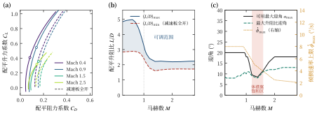

**图 4**　规划模型从配平表插值得到的气动特性。(a) 配平极曲线，空心圆是最大升阻比点，虚线为减速板全开；
(b) $`L/D`$ 的可调范围，第 0 课能量带的上下界由它而来，其中 $`(L/D)_\text{min}`$ 取可用最大迎角、减速板全开时的值；
(c) 可用最大迎角、最大升阻比迎角（左轴）和倾侧速率上限（右轴）。Mach 1.2–1.6 体襟翼饱和，可用迎角降到 9–12°。

### 1.4 流映射（flow map）

SCP 和 MPC 都不直接使用 $`\dot x = f(x,u)`$，而是使用它在一个时间步上的积分结果，即**流映射**：

```math
x_{k+1} = \Phi\big(x_k,\ u_k,\ u_{k+1},\ \Delta t\big)
```

每个区间用 3 个 RK4 子步积分。控制量在区间内按一阶保持（FOH）线性插值：$`u(t) = u_k + (u_{k+1}-u_k)\,t/\Delta t`$。
`PlanningModel.flow` 一次调用就能对所有区间同时积分。

---

## 第 2 课 能量管理与航迹几何

> 代码：`sim/gnc/geometry.py`

SCP 是局部方法，只在初值附近改进。左转还是右转、降 33 号还是 15 号跑道，这类离散选择它自己做不了。
在 SCP 之前，先用几何方法把离散决策定下来，再构造一条大致可行的初值轨迹。航天飞机的 TAEM 制导也是这个思路，
靠的是 HAC（Heading Alignment Cone，本仿真简化为圆柱）。

### 2.1 目标：ALI 与 HAC 的几何

取 `ApproachConfig` 的默认值：

| 量 | 值 | 说明 |
|---|---|---|
| 外下滑道角 $`\gamma_\text{OGS}`$ | −20° | 轻载 Orbiter 的数值 |
| OGS 瞄准点 | 入口前 1500 m | 真实 Orbiter 为 7500 ft，原因见第 5 课 |
| ALI 高度 | 跑道上方 3000 m | |
| ALI 位置 | $`x_\text{ALI} = -1500 - 3000/\tan 20^\circ \approx -9742`$ m | |
| ALI 速度 | 290 KEAS（≈149 m/s EAS） | |
| 五边前段（WP2 → ALI） | 2500 m 直线，WP2 在 $`x \approx -12242`$ m | |
| HAC 半径 | 5500 m | 两侧都可以 |

SCP 的终端目标因此是完整的 6 维状态：

```math
x_f = \big[\,E_\text{ALI},\ N_\text{ALI},\ h_\text{rwy}+3000,\ V_\text{TAS}(290\,\text{KEAS}),\ -20^\circ,\ \psi_\text{rwy}\,\big]
```

### 2.2 Dubins CSC 航迹

从当前位置 $`p_0`$、航向 $`\psi_0`$ 到 WP2（航向等于跑道方向），水平面上最短的“转弯–直线–转弯”路径叫 Dubins CSC 路径：

- 第一个圆的半径 $`r_1`$ 由当前速度决定，取 45° 坡度的等速转弯半径 $`r_1 = V^2/(g\tan 45^\circ)`$，并限制在 3–40 km 之间；
- 第二个圆就是 HAC，半径 $`r_\text{HAC}`$；
- 两圆之间是公切线。

每个候选方案由以下组合确定：跑道端（33/15）× 第一个圆的转向（左/右）× HAC 侧（左/右）× HAC 上的额外圈数（0/1/2）。

**高速出生时的首转弯半径**：Mach 1.6、20 km 高度，45° 坡度的转弯半径是 22.9 km，转回来要走 115 km，按这个半径估算太保守。
实际转弯时飞机边下滑边减速，动压大致不变、真空速下降，转弯半径（$`\propto V^2`$）越转越小。
`effective_turn_radius` 把转弯分成 12 段积分，每段：

```math
n_\text{max} = \min\!\Big(\frac{C_{L,\max}\,\bar q S}{mg},\ 2\Big),\quad \phi = \min\!\big(\arccos(1/n_\text{max}),\ 55^\circ\big),\quad r = \frac{V^2}{g\tan\phi},\quad \Delta E_h = \frac{r\,\Delta\theta}{(L/D)_\text{max}\sqrt{\cos\phi}}
```

然后由新的 $`E_h`$ 和保持的 $`\bar q`$ 反解出 $`h`$ 和 $`V`$。这个“减速转弯半径”会作为额外的 $`r_1`$ 候选。

### 2.3 沿路径的能量预算

对每条候选路径，`path_energy_budget` 沿路径采样，估算所需能量的上下界：

**第 1 步：** 假设能量高度随路径长度线性下降，$`E_h(s) = E_{h,0} + (E_{h,f}-E_{h,0})\,s/S`$；
动压在前 2/3 路径内从当前值线性过渡到 ALI 的值。由 $`E_h`$ 和 $`\bar q`$ 反解出 $`h(s)`$、$`V(s)`$ 和 $`M(s)`$：

```math
h + \frac{\bar q}{\rho(h)\,g} = E_h \quad(\text{对 } h \text{ 二分})
```

**第 2 步：** 由路径曲率 $`\kappa`$ 求所需倾侧角 $`\phi = \arctan(V^2|\kappa|/g)`$。

**第 3 步：** 计入顺逆风，地速比为 $`\eta = (V + w_\parallel)/V`$。

**第 4 步：** 累加：

```math
\Delta E_\text{min} = \sum \frac{\Delta s}{(L/D)_\text{max}(M)\,\sqrt{\cos\phi}\;\eta}, \qquad
\Delta E_\text{max} = \sum \frac{\Delta s}{(L/D)_\text{min}(M)\;\eta\;(0.85\ \text{if turning})}
```

这里转弯的折减用了 $`\sqrt{\cos\phi}`$，比第 0 课推出的 $`\cos\phi`$ 温和一些。这是经验取值，转弯时速度和迎角会一起调整。

候选方案可行的条件是能量落在能量带内，并且两端各留余量：

```math
1.04\,\Delta E_\text{min} \;\le\; \Delta E_\text{avail} \;\le\; 0.97\,\Delta E_\text{max}
```

再定义**能量带位置**：

```math
b = \frac{\Delta E_\text{avail} - \Delta E_\text{min}}{\Delta E_\text{max} - \Delta E_\text{min}} \in [0, 1]
```

$`b=0`$ 表示全程都得以最大升阻比飞，$`b=1`$ 表示全程都得开满减速板。目标取 $`b^\star = 0.35`$，偏低一侧：
阻力随时可以加，升阻比却不能超过最大值。可行方案里按下面的评分取最小（`plan_score`）：

```math
J_\text{route} = |b - 0.35| + 0.04\max(w_\text{tail}-2,\,0) + 0.05\,n_\text{loops} + 1.5\times10^{-6}\,S + \dots
```

各项依次偏好逆风着陆、少绕圈、航迹短。拉长的航迹还要加上逆风暴露量和 HAC 半径偏离标称值的惩罚。

### 2.4 先判断能量多了还是少了

标称方案都不可行时，`energy_direction` 先判断能量是多了还是少了：

- 只要有一条路线的 $`\Delta E_\text{avail} \gt  0.97\,\Delta E_\text{max}`$，就判为**过剩**，然后拉长航迹：
  - 对每种拓扑，把 HAC 半径乘以系数 $`k \in [0.76, 2.2]`$，先网格搜索再二分，使 $`b`$ 落在 0.35；圈数只是把搜索带到下一个区间，所以不同圈数之间没有空档；
  - 还不行就试 S 形转弯（偏出 60° 或 90°，偏出段长度连续搜索）和起始盘旋（半径从可飞的最小值开始连续搜索）；
  - 拉长后的航迹还要满足一个鲁棒性条件：逆风增强 30% 时仍然可达。
- 所有路线都不够时，判为**不足**，改用缩短的进近：降低 ALI、缩短五边前段、缩小 HAC。
- 如果把首转弯换成亚声速半径就够得着，判为**转弯受限**（TURN LIMITED）。超声速时升力只能提供约 1 g，飞机暂时转不回来，但能量并不缺。

先判方向，是因为早期版本先试缩短方案，高能量出生点经常被错配到低能量方案上，还报 LOW ENERGY。

### 2.5 构造初值轨迹

选定路线后，`initial_guess` 把几何路径变成一条完整的 $`(X, U, t_f)`$：

```math
\begin{aligned}
&h(s),\ V(s) \leftarrow (E_h(s),\ \bar q(s)) && \text{同 2.3} \\
&\gamma = \arctan(dh/ds), && \phi = \text{clip}\big(\arctan(V^2\kappa/g),\ \pm55^\circ\big) \\
&n = \cos\gamma/\cos\phi, && C_L = \frac{n\,mg}{\bar q S},\quad \alpha = C_L^{-1}(C_L, M, \delta_{sb}) \\
&\delta_{sb} = \text{clip}\Big(160\big(1 - \tfrac{(L/D)_\text{need}}{(L/D)_\text{max}}\big),\ 0,\ 70\Big), && (L/D)_\text{need} = S/\Delta E_\text{avail} \\
&t(s) = \int \frac{ds}{V\cos\gamma + w_\parallel}
\end{aligned}
```

最后按时间均匀重采样到 $`N`$ 个节点，首节点等于当前状态，末节点等于 ALI。

**例子**（3.6 节的迭代日志也用它）：出生在 $`(E,N) = (-30, -25)`$ km、高度 15 km、$`V=270`$ m/s（Mach 0.91）、$`\gamma = -6^\circ`$、航向 045°。
`select_plan` 用 44 ms 选出 RWY15、右侧 HAC、0 圈，能量预算为
$`\Delta E_\text{min} = 11.8`$ km，$`\Delta E_\text{avail} = 14.2`$ km，$`\Delta E_\text{max} = 19.1`$ km，能量带位置 $`b = 0.33`$。
初值的飞行时间是 249 s，对应 $`N = 35`$ 个节点。它和 SCP 的迭代过程画在图 5 里。

---

## 第 3 课 序列凸优化（SCP）

> 代码：`sim/gnc/scp.py`。方法属于 Szmuk、Açıkmeşe、Malyuta 等人发展的 PTR（penalized trust region）一类序列凸化，参考文献 [1][2]。

### 3.1 连续时间问题

```math
\begin{aligned}
\min_{x(\cdot),\,u(\cdot),\,t_f}\quad & t_f \;+\; \text{(控制平滑与能耗正则项)} \\
\text{s.t.}\quad & \dot x = f(x, u), \qquad x(0) = x_0, \qquad x(t_f) = x_f \\
& \alpha_\text{min} \le \alpha \le \alpha_\text{max}(M), \quad |\phi| \le \phi_\text{max}(M), \quad 0 \le \delta_{sb} \le 98.6^\circ \\
& |\dot\alpha| \le 2^\circ/\text{s}, \quad |\dot\phi| \le \dot\phi_\text{max}(M), \quad |\dot\delta_{sb}| \le 5^\circ/\text{s} \\
& 4 \le \bar q(h,V) \le 15\ \text{kPa}, \qquad n_z(h,V,\alpha) \le 2.5\,g \\
& h \ge T(E,N) + 600\ \text{m}, \qquad -35^\circ \le \gamma \le 12^\circ, \qquad V \ge 70\ \text{m/s}
\end{aligned}
```

这个问题非凸，难点有三处：

1. 动力学 $`f`$ 是非线性的：三角函数、插值表、大气密度随高度呈指数变化；
2. 动压、过载、地形约束都是状态的非线性函数；
3. 终端时间 $`t_f`$ 也是决策变量，网格长度本身未知。

SCP 在当前猜测附近把问题线性化，得到一个凸子问题，解出来当作新的猜测，反复迭代。怎样保证收敛、不被线性化误差带偏，是下面几节的内容。

### 3.2 时间伸缩：把 $`t_f`$ 变成普通变量

令 $`t = s\,\tau`$，$`\tau \in [0,1]`$，其中 $`s \equiv t_f`$ 是一个标量决策变量。于是

```math
\frac{dx}{d\tau} = s\, f(x, u)
```

把 $`\tau`$ 等分成 $`K = N-1`$ 段，$`\Delta\tau = 1/K`$，每段的物理时长是 $`s\,\Delta\tau`$。这样问题的网格固定了，$`s`$ 只是一个普通变量。

### 3.3 离散化：一阶保持 + 精确流映射 + 有限差分雅可比

控制量取一阶保持（FOH）：$`u(\tau) = (1-\lambda)u_k + \lambda u_{k+1}`$，$`\lambda \in [0,1]`$。
设上一轮的解为 $`(\bar x, \bar u, \bar s)`$，把流映射在它附近做一阶展开：

```math
x_{k+1} \;\approx\; A_k x_k + B^-_k u_k + B^+_k u_{k+1} + S_k\, s + z_k
```

```math
A_k = \frac{\partial\Phi}{\partial x_k},\quad B^-_k = \frac{\partial\Phi}{\partial u_k},\quad B^+_k = \frac{\partial\Phi}{\partial u_{k+1}},\quad S_k = \Delta\tau\,\frac{\partial\Phi}{\partial(\Delta t)},\quad
z_k = \Phi(\bar x_k,\bar u_k,\bar u_{k+1},\bar s\Delta\tau) - A_k\bar x_k - B^-_k\bar u_k - B^+_k\bar u_{k+1} - S_k\bar s
```

教科书一般对 $`\dot x = f`$ 线性化，再把 $`A(t)`$、$`B(t)`$ 和状态转移矩阵一起积分。
这里直接对 RK4 流映射做中心差分：

```math
A_k e_i \approx \frac{\Phi(\bar x_k + \varepsilon_i e_i,\,\cdot) - \Phi(\bar x_k - \varepsilon_i e_i,\,\cdot)}{2\varepsilon_i}
```

扰动量为 $`\varepsilon_x = (2, 2, 2\ \text{m},\ 0.05\ \text{m/s},\ 10^{-4},\ 10^{-4}\ \text{rad})`$，$`\varepsilon_u = (0.02^\circ,\ 10^{-3}\ \text{rad},\ 0.1^\circ)`$。
6 个状态、3+3 个控制和 1 个时间，共 13 个方向，每个方向正负各一次，加上基准点，一共 27 组。
$`K`$ 个区间 × 27 组堆成一个批次，一次向量化调用算完（`PlanningModel.flow_jac`），49 段约 10 ms。
气动是查表插值，推导解析雅可比又麻烦又容易错，差分省事得多。

### 3.4 凸子问题

每轮迭代解下面这个问题。所有量先缩放到 O(1)（见 3.5），下面省略帽子记号：

```math
\begin{aligned}
\min\quad & \underbrace{w_{t}\,s}_{\text{飞行时间}}
 + \underbrace{w_{\Delta u}\tfrac{N}{40}\sum_k \lVert u_{k+1}-u_k\rVert_2^2}_{\text{控制平滑}}
 + \underbrace{w_\phi\tfrac{40}{N}\sum_k \phi_k^2 + w_{sb}\tfrac{40}{N}\sum_k \delta_{sb,k}}_{\text{少压坡度、少开减速板}} \\
& + \underbrace{w_\nu\sum_k\lVert\nu_k\rVert_1}_{\text{虚拟控制}}
 + \underbrace{\textstyle\sum_i w_{f,i}\,|\sigma_{f,i}|}_{\text{终端松弛}}
 + \underbrace{w_\text{soft}\textstyle\sum_k(\sigma_{q,k} + \sigma'_{q,k} + \sigma_{n,k} + 0.01\,\sigma_{T,k})}_{\text{软约束}} \\
& + \underbrace{w_\text{tr}\big(\lVert X-\bar X\rVert_F^2 + \lVert U-\bar U\rVert_F^2 + (s-\bar s)^2\big)}_{\text{信赖域惩罚}} \\[4pt]
\text{s.t.}\quad
& x_{k+1} = A_k x_k + B^-_k u_k + B^+_k u_{k+1} + S_k s + z_k + \nu_k && \text{线性化动力学 + 虚拟控制} \\
& x_0 = x(t_0), \qquad x_{N-1} - x_f = \sigma_f && \text{初始状态；终端（带松弛）} \\
& \alpha_{\text{lo},k} \le \alpha_k \le \alpha_{\text{hi},k}, \quad |\phi_k| \le \phi_{\text{max},k}, \quad 0 \le \delta_{sb,k} \le 98.6^\circ && \text{控制边界} \\
& |u_0 - u_\text{prev}| \le (3^\circ,\ 12^\circ,\ 8^\circ) && \text{与当前指令衔接} \\
& |u_{k+1} - u_k| \le \dot u_\text{max}\cdot s\,\Delta\tau && \text{速率约束（对 } s \text{ 仍是线性的！）} \\
& \bar q_k + q_h(h_k - \bar h_k) + q_V(V_k - \bar V_k) \in [\,4 - \sigma'_{q,k},\ 15 + \sigma_{q,k}\,]\ \text{kPa} && \text{动压（线性化，软）} \\
& \bar n_k + n_h\Delta h_k + n_V\Delta V_k + n_\alpha\Delta\alpha_k \le 2.5 + \sigma_{n,k} && \text{过载（线性化，软）} \\
& h_k \ge T(\bar E_k,\bar N_k) + \nabla T\cdot(E_k-\bar E_k,\ N_k-\bar N_k) + 600 - \sigma_{T,k} && \text{地形净空（线性化，软）} \\
& \gamma_k \in [-35^\circ, 12^\circ], \quad V_k \ge 70, \quad \max(0.25\bar s, 20) \le s \le 2000\ \text{s} \\
& \lVert x_k - \bar x_k\rVert_\infty \le r, \quad \lVert u_k - \bar u_k\rVert_\infty \le 2r, \quad |s - \bar s| \le r && \text{硬信赖域}
\end{aligned}
```

代码中的权重：$`w_t = 1`$，$`w_{\Delta u} = 3`$，$`w_\phi = 0.05`$，$`w_{sb} = 0.002`$，$`w_\nu = 1000`$，$`w_\text{soft} = 50`$，$`w_\text{tr} = 1`$，
$`w_f = (300, 300, 300, 60, 60, 60)`$。

几点说明：

**(a) 虚拟控制 $`\nu_k`$。** 线性化后的约束可能与初始状态、终端状态互相矛盾，导致子问题人为不可行（artificial infeasibility）。
在动力学里加一个自由变量 $`\nu_k`$，用很大的 L1 权重惩罚，子问题就总是可行的。L1 是精确罚函数：
只要原问题可行且权重够大，最优解里的 $`\nu`$ 恰好为零，不只是接近零。

**(b) 信赖域。** 线性化只在 $`(\bar x, \bar u, \bar s)`$ 附近可信，每步走多远要有限制。这里两种都用：

- 二次惩罚 $`w_\text{tr}\lVert\cdot\rVert^2`$：PTR 的标准做法，让步长成为优化的一部分；
- 硬性 L∞ 盒子 $`r`$：根据线性化质量自适应调节。

线性化好不好，用**非线性缺陷**（defect）衡量：把子问题的解代回非线性流映射，看节点之间接不接得上：

```math
d_k = \big(\Phi(x_k, u_k, u_{k+1}, s\Delta\tau) - x_{k+1}\big) \oslash D_x, \qquad d_\text{max} = \max_k \lVert d_k\rVert_\infty
```

调节规则：$`d_\text{max} \gt  0.05`$ 时 $`r \leftarrow \max(0.5r,\ 0.02)`$；$`d_\text{max} \lt  0.01`$ 时 $`r \leftarrow \min(1.5r,\ 2)`$；子问题求解失败时 $`r \leftarrow 0.5r`$。初值 $`r_0 = 1`$。

> $`\nu`$ 和 $`d`$ 要分清：$`\nu`$ 是线性化模型里的残差，$`d`$ 是非线性模型里的残差。
> 3.6 节日志的第 1 步，$`\nu = 0`$，$`d`$ 却有 0.35：线性模型以为已经接上了，实际差得很远。收敛判据看的是 $`d`$。

**(c) 速率约束对 $`s`$ 是线性的。** $`|u_{k+1}-u_k| \le \dot u_\text{max}\,s\,\Delta\tau`$ 的右边是变量 $`s`$ 乘以常数，所以仍然是凸约束。
这是时间伸缩顺带的好处：飞得越久，每段越长，允许的控制变化越大，这层关系在凸问题里能直接写出来。

**(d) 非线性路径约束要线性化，并且设为软约束。** 动压、过载和地形都在 $`\bar x`$ 处做一阶展开。例如

```math
\bar q(h,V) \approx \bar q + \underbrace{\tfrac12\bar V^2\frac{\partial\rho}{\partial h}}_{q_h}(h-\bar h) + \underbrace{\bar\rho\bar V}_{q_V}(V-\bar V)
```

它们都带非负松弛变量 $`\sigma`$，以 $`w_\text{soft}=50`$ 计入代价。初值往往违反这些约束，设成硬约束的话第一轮就不可行。
地形先在 800 m 网格上做最大值滤波和平滑（`TerrainField`），免得梯度在山脊尖角处剧烈跳变。

**(e) 终端约束也带松弛。** 终端误差 $`\sigma_f`$ 以加权 L1 惩罚。位置和高度的权重是 300，速度和角度是 60。
终端节点的倾侧角限制在 3° 以内，到 ALI 时机翼基本放平。

**(f) 起始控制量的处理。** 迎角上下界会自动放宽到“从当前指令按速率限制能够到达的范围”。
不然当前迎角一旦高于该 Mach 数下的控制余量上限，第一轮子问题就不可行。

### 3.5 缩放

$`E`$、$`N`$ 是 $`10^4`$ m 量级，$`\gamma`$ 是 $`10^{-1}`$ rad 量级，不缩放的话内点法数值条件很差。所有变量都做仿射缩放：

```math
\hat x = (x - x_c) \oslash D_x, \quad D_x = (10\,\text{km},\ 10\,\text{km},\ 3\,\text{km},\ 100\,\text{m/s},\ 0.3,\ 1); \qquad
\hat u = u \oslash D_u, \quad D_u = (10^\circ,\ 0.5\,\text{rad},\ 50^\circ); \qquad \hat s = s/100\,\text{s}
```

其中 $`x_c`$ 取起点和 ALI 的水平中点。雅可比矩阵也相应变换：$`\hat A = D_x^{-1} A D_x`$，$`\hat B = D_x^{-1} B D_u`$。
信赖域半径 $`r`$ 和缺陷 $`d`$ 都在缩放后的坐标里定义，$`r=1`$ 就是每个量最多变一个特征尺度。

### 3.6 迭代流程与收敛判据

```
输入：当前状态 x0、当前指令 u_prev、ALI 目标 xf、初值 (X̄, Ū, s̄)
r ← 1
for it = 1 … 12（热启动时 6）:
    沿 (X̄, Ū, s̄) 计算 A, B⁻, B⁺, S, z 和所有线性化约束系数   # 一次向量化调用
    解凸子问题（CLARABEL；失败时用 ECOS）
    if 不可行:  r ← r/2;  continue
    d_max ← 用非线性流映射计算的缺陷
    (X̄, Ū, s̄) ← 新解
    if d_max < 5e-3 且 ‖ν‖₁ < 1e-3 且（步长 < 2e-3 或代价相对变化 < 1%）:
        收敛，退出
    按 d_max 调整 r
```

子问题用 cvxpy 搭建，并采用 DPP（Disciplined Parametrized Programming）形式：所有随迭代变化的量
（$`A`$、$`B`$、$`z`$、边界、线性化系数、信赖域中心和半径）都声明为 `cp.Parameter`。
这样每个节点数 $`N`$ 只编译一次，之后迭代只更新参数，不用反复做规范化。
节点数按飞行时间选取，约每 7.5 s 一个节点：$`N = \text{clip}\big(5\,\text{round}(t_f/37.5),\ 20,\ 45\big)`$。

**2.5 节例子的迭代日志**（RWY15，$`N=35`$，本机原生 Python）：

| 迭代 | 步长 $`\lVert\Delta\rVert_\infty`$ | $`\lVert\nu\rVert_1`$ | 缺陷 $`d_\text{max}`$ | $`t_f`$ (s) | 代价 |
|---|---|---|---|---|---|
| 1 | 1.501 | 0.0000 | 0.3464 | 247.3 | 15.07 |
| 2 | 0.440 | 0.0000 | 0.0124 | 252.7 | 5.49 |
| 3 | 0.071 | 0.0000 | 0.0008 | 253.9 | 4.55 |
| 4 | 0.049 | 0.0000 | 0.0005 | 254.8 | 4.38 |
| 5 | 0.035 | 0.0000 | 0.0004 | 255.7 | 4.29 |
| 6 | 0.027 | 0.0000 | 0.0004 | 256.5 | 4.23 |
| 7 | 0.024 | 0.0000 | 0.0003 | 257.4 | 4.20 |

7 次迭代收敛，用时约 320 ms，终端误差在显示精度下为零。

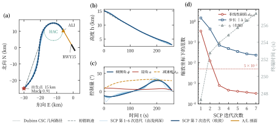

**图 5**　上表的迭代过程，由 `planner.plan` 实际求解时逐轮记录。(a) 水平航迹：灰色为几何初值，浅蓝到深蓝为第 1–6 次迭代，
深蓝粗线为收敛解，橙色为 A/L 剖面；(b) 高度；(c) 收敛解的控制量，浅蓝细线是中间迭代的倾侧角；
(d) 缺陷和步长（左轴，对数坐标）以及终端时间（右轴）。

- 第 1 步迈得很大（1.5 个特征尺度），线性化明显失准，缺陷 0.35。第 2 步就压到 0.012，之后缺陷和步长都平稳减小。
- $`t_f`$ 从 247 s 涨到 257 s。初值的能量调度不是最优的，SCP 多飞了 10 s，换来更平滑的控制。
- 最后几步代价的相对变化不到 1%，满足收敛判据。

### 3.7 接受与恢复

SCP 的结果满足以下条件才算好计划：缺陷 < 0.02，终端误差满足 $`|\Delta E|,|\Delta N| \lt  300`$ m、$`|\Delta h| \lt  150`$ m、
$`|\Delta V| \lt  8`$ m/s、$`|\Delta\gamma| \lt  3^\circ`$、$`|\Delta\psi| \lt  8^\circ`$。

没到 ALI 时，`planner.plan` 看终端误差往哪边偏，再做调整。判断依据是到 ALI 时的能量高度超量：

```math
e_\text{exc} = \Delta h + \frac{V_\text{ALI}\,\Delta V}{g}
```

- $`e_\text{exc} \gt  0`$，即太高或太快：把能量带目标 $`b^\star`$ 下调 $`e_\text{exc}/(\Delta E_\text{max}-\Delta E_\text{min})`$，然后选一条更长的路线（更大的 HAC、多一圈、S 形转弯或盘旋）；
- 太低或太慢：换成缩短的进近；
- 结果完全不可用：重新做几何选择；
- 同一条路线不会重复尝试。

反过来，几何估算判为不可达、SCP 实际却到了 ALI 的，以 SCP 为准，几何估算只是启发式。

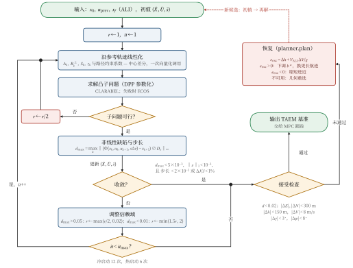

**图 6**　SCP 的迭代、接受检查和恢复流程（`scp.py`：`ScpSolver.solve`；`planner.py`：`plan`）。

### 3.8 什么时候重规划

只有 TAEM 段会重规划，并且距 ALI 要超过 35 s。触发条件：

- 定时：每 20 s 一次，从当前基准热启动；
- 误差过大：水平偏差 > 1500 m，或高度偏差 > 600 m，或能量偏差 > 900 m，或 MPC 连续失败 3 次；
- 风变化：10 m 高度的风向量变化超过 3 m/s。

HAC 截获之前（且距 ALI > 60 s），重规划还可以重选跑道端和 HAC 侧，这是热启动 SCP 做不到的离散决策。
为防止来回切换加了滞回：每次飞行最多切换 2 次，间隔至少 40 s。

实时服务里规划跑在独立进程中，浏览器版跑在独立的 Web Worker 中，求解期间仿真循环不卡。

---

## 第 4 课 模型预测控制（MPC）

> 代码：`sim/gnc/mpc.py`

### 4.1 为什么还要 MPC

SCP 给出的是开环最优轨迹，按时间直接回放控制序列 $`\bar u(t)`$，飞机很快就会偏。原因至少有四个：

1. **模型误差**：规划用的是 3-DOF 配平表，真实对象是 6-DOF 分片气动加飞控，内环有动态响应；
2. **风和湍流**：规划只知道平均风廓线，实际还有阵风、Dryden 湍流，以及雷暴中的上升和下沉气流；
3. **离散化**：规划节点间隔约 7.5 s；
4. **计算延迟**：一次规划要几百毫秒到几秒，期间飞机一直在飞。

因此需要闭环跟踪。MPC 每 0.4 s 以当前实际状态为起点，在基准轨迹附近解一个短时域的线性二次问题，
只执行第一段控制，下次重新求解，即**滚动时域**（receding horizon）。

### 4.2 按空间位置重索引

按时间跟踪有个问题。飞机因为逆风比计划晚 10 s 到某处，如果还按时钟跟踪 $`\bar x(t)`$，
MPC 会认为它落后了 1.5 km，压低机头加速去追。对滑翔机来说，这是白白浪费能量。

改为按空间位置找参考点：在上次索引附近的窗口内（往回 30 个点，往前 400 个点，保证单调前进）
找加权距离最近的基准点，再在线段上细化到小数索引：

```math
i^\star = \arg\min_i \big\lVert W\,(p_i - p)\big\rVert^2, \qquad W = \text{diag}(1,\ 1,\ w_h)
```

TAEM 段取 $`w_h = 3`$，高度偏差计入投影，使参考点同时反映能量状态。
A/L 段取 $`w_h = 0.15`$，几乎只按水平位置投影，因为 A/L 的纵向由“按距离给高度”的着陆律负责（第 5 课）。

找到 $`i^\star`$ 对应的基准时间 $`\tau_0`$ 后，预测时域取 $`t_k = \tau_0 + k\Delta t`$，$`k = 0..K`$，其中 $`K=28`$，$`\Delta t = 1`$ s。

### 4.3 沿基准的线性时变模型

把基准插值到这些时刻，得到 $`(x^r_k, u^r_k)`$。仍然用 RK4 流映射加中心差分做线性化，不过这里改为零阶保持（ZOH），每段 2 个 RK4 子步。
定义偏差 $`\delta x = x - x^r`$，$`\delta u = u - u^r`$：

```math
\delta x_{k+1} = A_k\,\delta x_k + B_k\,\delta u_k + c_k, \qquad c_k = \Phi(x^r_k, u^r_k, \Delta t) - x^r_{k+1}
```

$`c_k`$ 是基准轨迹自身的缺陷。基准由 SCP 节点插值而来，又拼上了 A/L 剖面，并不严格满足动力学，所以显式写进模型。
航向分量要把差值包裹到 $`(-\pi, \pi]`$。

### 4.4 凝聚（condensing）

把 $`K`$ 步的预测写成只关于控制序列的形式。令 $`\delta U = [\delta u_0; \dots; \delta u_{K-1}]`$（84 维），则

```math
\delta X = \Phi_x\,\delta x_0 + \Gamma\,\delta U + C
```

其中 $`\Phi_x`$、$`\Gamma`$、$`C`$ 递推构造：

```math
\Phi_{k+1} = A_k\Phi_k,\qquad \Gamma_{k+1} = A_k\Gamma_k + [\,0\ \cdots\ B_k\ \cdots\ 0\,],\qquad C_{k+1} = A_k C_k + c_k
```

凝聚后决策变量只剩 84 个控制量，没有状态变量和等式约束，是一个小而稠密的 QP。

### 4.5 代价函数与权重

权重按 Bryson 法则取：每项除以可接受偏差的平方，$`Q_{ii} = 1/\sigma_i^2`$。调参就成了给每个量定一个可接受偏差。

水平偏差在 E、N 两个方向上不该一视同仁：侧偏要压紧，沿航迹偏差可以放宽（理由见 4.2）。先转到航迹坐标系再加权：

```math
Q^{(EN)}_k = c\,c^\top/\sigma_\perp^2 + a\,a^\top/\sigma_\parallel^2, \qquad a = (\sin\psi^r_k,\ \cos\psi^r_k),\ \ c = (\cos\psi^r_k,\ -\sin\psi^r_k)
```

另外加了一个能量高度项。$`\delta E_h \approx \delta h + (V^r/g)\,\delta V`$ 是状态偏差的线性组合，于是

```math
Q_k = \text{blkdiag}\Big(Q^{(EN)}_k,\ \tfrac{1}{\sigma_h^2},\ \tfrac{1}{\sigma_V^2},\ \tfrac{1}{\sigma_\gamma^2},\ \tfrac{1}{\sigma_\psi^2}\Big) + \frac{e_k e_k^\top}{\sigma_E^2},\qquad e_k = (0,\ 0,\ 1,\ V^r_k/g,\ 0,\ 0)
```

终端步 $`Q_K`$ 再乘以一个系数（TAEM 为 3，A/L 为 2）。完整的代价是

```math
J = \sum_{k=0}^{K}\delta x_k^\top Q_k\,\delta x_k \;+\; \sum_{k=0}^{K-1}\delta u_k^\top R_u\,\delta u_k \;+\; \sum_{k=0}^{K-1}(\delta u_k - \delta u_{k-1})^\top R_\Delta\,(\delta u_k - \delta u_{k-1}),
\qquad \delta u_{-1} := u_\text{prev} - u^r_0
```

最后一项里的 $`\delta u_{-1}`$ 让第一步的变化量相对上一次实际下发的指令计算，MPC 每次更新时指令不会跳变。

| $`\sigma`$ | 侧偏 | 沿航迹 | 高度 | 能量 | $`\gamma`$ | $`\psi`$ | $`V`$ | $`\alpha`$ | $`\phi`$ | $`\delta_{sb}`$ | $`\Delta\alpha`$ | $`\Delta\phi`$ | $`\Delta\delta_{sb}`$ | 终端 |
|---|---|---|---|---|---|---|---|---|---|---|---|---|---|---|
| TAEM | 250 m | 4000 m | 150 m | 250 m | 3° | 10° | 25 m/s | 4° | 35° | 40° | 1° | 6° | 6° | ×3 |
| A/L | 40 m | 6000 m | 25 m | 60 m | 1.5° | 4° | 8 m/s | 3° | 20° | 30° | 1° | 5° | 6° | ×2 |

从 TAEM 到 A/L，侧偏的容许值从 250 m 收紧到 40 m，沿航迹反而放宽了。

### 4.6 约束与 QP

```math
\min_{\delta U}\ \tfrac12\,\delta U^\top H\,\delta U + g^\top\delta U \qquad \text{s.t.}\qquad l \le \begin{bmatrix} I \\ D\end{bmatrix}\delta U \le u
```

```math
H = \Gamma^\top\bar Q\,\Gamma + \bar R_u + D^\top\bar R_\Delta D, \qquad g = \Gamma^\top\bar Q\,(\Phi_x\delta x_0 + C) - D^\top\bar R_\Delta\,d_0
```

$`D`$ 是差分矩阵，第一行相对于 $`u_\text{prev}`$ 取差分，$`d_0`$ 把 $`u_\text{prev}-u^r_0`$ 带进代价。约束分两类：

- **幅值**：$`\alpha \in [1^\circ, \alpha_\text{max}(M)]`$，$`|\phi| \le \phi_\text{lim}`$，$`0 \le \delta_{sb} \le 98.6^\circ`$。
  $`\phi_\text{lim}`$ 随阶段变化：TAEM 为 60°（超声速 70°），A/L 在 300 m 以上为 30°，以下为 12°。
- **速率**：$`|u_k - u_{k-1}| \le \dot u_\text{max}\Delta t`$，约束的是完整控制量的增量，所以基准自身的增量 $`\Delta u^r`$ 也要算进边界。

基准本身超限时（上下界交叉），把边界放宽到包含基准，保证 QP 可行。

**求解**：原生版用 OSQP。$`H`$ 的上三角稀疏结构固定不变，每次只更新数值（`update(Px=…)`）并热启动，一次约 10–13 ms。
浏览器版用 Clarabel 解同一个 QP。两者都失败时，退回到“无约束最小二乘解 + 截断到边界”，并记录状态 `fallback-lsq`。

### 4.7 执行

MPC 每 0.4 s 求解一次，制导 10 Hz。两次求解之间，按时间在 MPC 控制序列上线性插值取指令，
这样指令连续，MPC 预测的前几步也都用上了，不只是第一步。

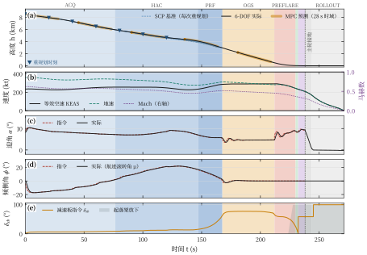

**图 7**　图 1 那次飞行的时间历程，背景色为飞行阶段，竖虚线为主轮接地。(a) 高度：细虚线是每次重规划给出的 SCP 基准
（▼ 为重规划时刻，每 20 s 一次），橙色粗线是几个时刻的 MPC 28 s 预测，和实际轨迹基本重合；(b) 速度和 Mach 数；
(c)(d) 迎角、倾侧角的指令与实际值，倾侧角的实际值取航迹滚转角 $`\mu`$；(e) 减速板指令和起落架。

---

## 第 5 课 进近与着陆：Orbiter 式剖面和拉平律

> 代码：`sim/gnc/approach.py`。依据 NASA JSC-23266《Approach, Landing and Rollout Flight Procedures Handbook》§4.3–4.7、§5.3.3、附录 B.3/B.4 [5]。

A/L 段用预先算好的几何剖面，不做在线优化：这一段只有 60 s 左右，精度要求很高，
真实轨道器用的也是固定剖面，在线优化只会多出不确定性。

### 5.1 垂直剖面：从 −20° 到接地

沿跑道中线（$`x`$ 为距入口的距离，入口前为负），重心离跑道的高度 $`H(x)`$ 由四段组成。
下表的关键点由 `vertical_profile(ApproachConfig())` 算出。

**① 外下滑道 OGS**：一条 −20° 的直线，瞄准入口前 1500 m：

```math
H_\text{OGS}(x) = (x_\text{aim,OGS} - x)\tan 20^\circ
```

**② 预拉平圆弧**：一段半径 $`R = 8000`$ m 的圆弧，与 OGS 相切，并与“IGS 上方 $`d_1 = 17.5`$ ft”这条线相切。
两条直线的交点为

```math
x_\text{int} = \frac{x_\text{aim,OGS}\,t_o - x_\text{aim,IGS}\,t_i - d_1}{t_o - t_i},\qquad t_o = \tan 20^\circ,\ t_i = \tan 1.5^\circ
```

切点到交点的距离为 $`R\tan(\Delta\gamma/2)`$，$`\Delta\gamma = 18.5^\circ`$。圆心在 OGS 切点沿法向 $`R`$ 处。
沿这段圆弧飞行需要的法向过载增量约为 $`V^2/(gR) \approx 150^2/(9.81 \times 8000) \approx 0.29\,g`$，和手册中的 0.33 g 一致。

**③ 指数过渡**：如果一直沿圆弧飞到与 IGS 相切，曲率会在切点突变。所以在圆弧上高出 IGS $`d_2 = 35`$ ft 的地方离开圆弧，
用指数曲线渐近地并入 IGS：

```math
H(x) = H_\text{IGS}(x) + d_2\,e^{-(x-x_e)/\lambda}, \qquad \lambda = \frac{d_2}{-H'_\text{arc}(x_e) - \tan 1.5^\circ}
```

$`\lambda`$ 的取值保证在 $`x_e`$ 处斜率连续。

**④ 内下滑道 IGS**：−1.5°，瞄准入口后 520 m。

**⑤ 最终拉平**：见 5.4。

| 关键点 | $`x`$（相对入口） | 重心高度 |
|---|---|---|
| ALI | −9742 m | 3000 m |
| 拉起开始（OGS 切点） | −2897 m | 508 m（≈1670 ft） |
| 离开圆弧，进入指数段 | −662 m | 41.6 m |
| 指数段时间常数 | $`\lambda = 291`$ m | |
| 进入最终拉平（基准） | −114 m | 18.2 m |
| 基准接地点 | +722 m | 4.4 m（接地姿态时重心高度） |

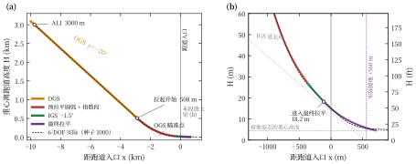

**图 8**　A/L 垂直剖面，颜色区分各段；黑色虚线是图 1 那次飞行的实际重心高度。(a) 从 ALI 到接地的全程；(b) 入口附近放大，
实际接地点在入口后 560 m，基准接地点在 722 m。

**OGS 瞄准点为什么从 7500 ft 改成 1500 m。** 本仿真如果用 2.3 km 的瞄准点，拉起圆弧在入口前约 1.5 km 就结束了，
之后飞机要在 60 m 以下贴地平飞一公里多才到跑道。瞄准点拉近后，入口前 1.5 km 处主轮离地约 134 m（原来 58 m），
代价是 IGS 稳定段比手册要求的 5 s 短。

### 5.2 速度剖面

速度剖面沿着几何剖面积分得到（`_integrate`）：

**OGS 段保持等效空速。** 先由 EAS 剖面求出所需的 $`dV/dt`$，再反解需要的阻力：

```math
D_\text{req} = -m\frac{dV}{dt} - mg\sin\gamma \quad\Rightarrow\quad C_{D,\text{req}} = \frac{D_\text{req}}{\bar qS} \quad\Rightarrow\quad \delta_{sb} = C_D^{-1}(C_{D,\text{req}};\ \alpha, M)
```

其中迎角由升力平衡给出：$`L = mg\cos\gamma + mV\dot\gamma`$，$`\dot\gamma`$ 来自剖面曲率。

**预拉平之后，减速板保持一个常值。** 这个值用二分法求，目标是在接地时 TAS = 98 m/s（`_sb_preflare`）。
如果 0° 到 98.6° 的范围内找不到解，就把 OGS 的 EAS 以 10 kt 为步长调整，范围为 280–320 KEAS，强逆风且能量不足时最高可到 340 KEAS（`_adapt_eas`）。

**风切变项。** 顺风一般越近地面越弱。下降时飞机靠惯性保持地速，空速因此增加：

```math
\dot V = -\frac{D}{m} - g\sin\gamma - \frac{\partial w_\parallel}{\partial x}\,V_g\cos\gamma
```

**侧风。** 给出偏流角 $`\psi_\text{air} = \psi_\text{rwy} - \arcsin(w_\perp/V)`$。

另外，IGS 瞄准点和接地点会随顺逆风移动：逆风时每 m/s 后移 25 m，最多 400 m；顺风时每 m/s 前移 10 m，最多 250 m（`wind_aim`）。

### 5.3 进近段纵向律：按距离给高度

A/L 段的横向（倾侧角）和减速板仍由 MPC 给出，纵向改用经典着陆律（`al_vertical_accel`）。
早期版本纵向也交给 MPC，但 MPC 步长 1 s，跟不住 8 km 半径的拉起圆弧，曾经掉到基准下方 5 m。

着陆律按当前跑道坐标 $`x`$ 查出这个距离上应有的高度 $`H(x)`$，再算所需的垂直加速度：

```math
a_z = \underbrace{H''(x)\,v_x^2}_{\text{曲率前馈}} + k_h\,\underbrace{(H(x) - h)}_{e_h} + k_d\,\big(\underbrace{H'(x)\,v_x}_{\dot h_\text{ref}} - \dot h\big) + a_\text{int},
\qquad k_h = 0.2\ \text{s}^{-2},\ k_d = 0.8\ \text{s}^{-1}
```

- 第一项最要紧：以水平速度 $`v_x`$ 沿曲线飞，垂直加速度必须等于 $`H''v_x^2`$，否则必然离开曲线。
- 积分项 $`\dot a_\text{int} = k_i e_h`$，$`k_i = 0.03`$，限幅 ±1 m/s²，并带抗饱和。它用来修正配平表与 6-DOF 之间的升力差。
- 结果限幅在 $`[-0.6g,\ 1.2g]`$。
- **下沉率保护**：下沉不能超过拉平表（延伸到 80 ft 以上）在当前高度允许的值，即 $`a_z \ge k_d(\dot h_\text{min} - \dot h) - k\dot h`$。
  如果飞机在短五边偏高，宁可着陆点靠后，也不能为了回到剖面而俯冲出拉平救不回来的下沉率。

**从加速度到迎角。** 在垂直方向上做力平衡，阻力用当前的升阻比表示：

```math
L\Big(\cos\gamma\cos\phi - \frac{\sin\gamma}{L/D}\Big) = m(g + a_z)
\quad\Rightarrow\quad
C_{L,\text{req}} = \frac{L}{\bar q S\cdot G(h)}, \qquad \alpha = C_L^{-1}(C_{L,\text{req}};\ M, \delta_{sb}, \text{gear})
```

$`\gamma \lt  0`$ 时 $`-\sin\gamma/(L/D) \gt  0`$，即下降时阻力有向上的分量。
$`G(h)`$ 是地面效应修正：

```math
G(h) = 1 + 0.131\,e^{-h_\text{cg}/11\,\text{m}}
```

配平表是自由流数据，而 6-DOF 气动里有地面效应。不配平时，接地高度上的升力约增加 27%（手册说 L/D 约增加 25%）；
但地面效应同时带来低头力矩，需要升降副翼上偏来配平，最后几秒体襟翼又来不及动，所以配平后实际只剩约 9%。
上面的拟合式就是这个配平后的净增量。

**从 MPC 切换到着陆律**：在 ALI 处用 3 s 线性混合，避免指令跳变。

### 5.4 最终拉平：下沉率–高度表

真实轨道器的最终拉平跟踪一张下沉率–高度表（JSC-23266 §5.3.3）：52 ft 时 13 fps，2 ft 时 3 fps，中间线性，2 ft 以下保持 3 fps。写成公式：

```math
\dot h_\text{ref}(h) = -k\,(h + h_\text{off}), \qquad k = \frac{(13-3)\,\text{fps}}{(52-2)\,\text{ft}} = 0.2\ \text{s}^{-1},\quad h_\text{off} = 13\ \text{ft} = 3.96\ \text{m}
```

完全按表飞的话，高度满足一阶线性常微分方程，解是指数曲线：

```math
h(t) + h_\text{off} = (h_0 + h_\text{off})\,e^{-kt}
```

时间常数为 $`1/k = 5`$ s，对应地面距离 $`L_f = v_\text{ff}/k \approx 112/0.2 = 560`$ m。

> 渐近线是 $`h = -h_\text{off} \lt  0`$，不是 $`h = 0`$。接地前参考下沉率降不到零，飞机一直下到跑道上，
> 不平飘也不上飘，就是手册说的 “no float, no balloon”。起这个作用的就是 $`h_\text{off}`$。

**进入高度**：在表上的下沉率等于当前下沉率的高度进入拉平，并限制在 30–80 ft 之间：

```math
h_\text{FF} = \text{clip}\Big(\frac{-\dot h}{k} - h_\text{off},\ 30\,\text{ft},\ 80\,\text{ft}\Big)
```

下沉越快，进入越早。

**拉平律**（`flare_alpha`）：

```math
a_z = \text{clip}\Big(\underbrace{-k\,\dot h}_{\text{前馈：}\ddot h_\text{ref}} + k_d\big(\dot h_\text{ref}(h) - \dot h\big),\ -0.15g,\ 0.6g\Big)
```

前馈项是参考下沉率对时间的导数：$`\ddot h_\text{ref} = -k\dot h`$。低头方向只给 −0.15 g，因为轨道器的俯仰响应是非最小相位的：
升降副翼上偏抬头时，先要损失一部分升力。手册也要求这一阶段操纵量尽量小。

**防擦尾**：俯仰姿态限制为 $`\theta_\text{max} = 9.7^\circ + 5.3^\circ\cdot\text{clip}((h-10)/50,\,0,\,1)`$，换算成迎角上限 $`\alpha_\text{max} = \theta_\text{max} - \gamma`$。

**飘过接地点**：过了基准接地点还没接地（速度过高、顺风或风切变引起上飘）时，加大目标下沉率（按飘过的距离线性增加，飘过 300 m 时加满 1 m/s），
并逐步打开减速板（飘过 250 m 时开满），防止冲出跑道。

**横向**：拉平阶段用一个简单的中线保持律，坡度限制在 ±5°（$`y`$ 为侧偏，单位 m；$`\phi`$ 单位 rad）：

```math
\phi = \text{clip}\big(-0.012\,y - 0.08\,\dot y,\ \pm 5^\circ\big)
```

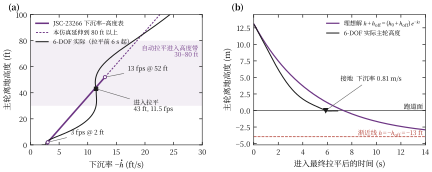

**图 9**　最终拉平律。(a) 下沉率–高度表和实际飞行轨迹（从进入拉平前 6 s 起）：飞机在 43 ft、11.5 ft/s 时进入拉平，
头一秒下沉率几乎不变，之后逐渐向表靠拢，以 2.7 ft/s 接地；(b) 进入拉平后的主轮高度和理想指数解。
理想解的渐近线在跑道面以下 13 ft，所以飞机一直下降到接地，不平飘。

### 5.5 接地与滑跑

- **主轮接地**：立即放减速伞（40 ft 锥形带条伞：引导伞 → 收口 → 全开），地速低于约 60 kt 时抛伞。
- **降前轮**：飞控切换到主轮着地模式，以 −1.5°/s 的俯仰角速率放下前轮，计入起落架力矩。
- **滑跑**：前轮转向 $`\delta = \text{clip}(-0.08\,y - 0.8\,\psi_\text{err},\ \pm8^\circ)`$（$`\psi_\text{err}`$ 和 $`\delta`$ 以度计）；地速 85 m/s 以下刹车 55%，15 m/s 以下刹车 100%（带防滑）；
  空速 80 m/s 以下减速板全开。升降副翼下偏卸载，防止减速伞的抬头力矩把前轮抬起来。

### 5.6 与真实轨道器的对比

| 阶段 | 真实轨道器（JSC-23266） | 本仿真 |
|---|---|---|
| 外下滑道 OGS | −20°（重载 −18°），瞄准入口前 7500 ft，300 KEAS，减速板保持空速 | −20°，入口前 1500 m，290 KEAS（随风 280–340） |
| 预拉平 | 2000 ft 开始；约 0.33 g 的等过载圆弧，在 1700 ft 与 OGS 相切 | 8 km 半径（≈0.29 g），约 1670 ft 切入 |
| 过渡到 IGS | 圆弧上高出 IGS 35 ft 处开始指数衰减 | 相同 |
| 内下滑道 IGS | −1.5°，瞄准入口后 1000 ft，至少稳定 5 s | −1.5°，瞄准入口后 520 m，稳定段较短 |
| 起落架 | 300 ± 100 ft 放下 | 90 m（≈300 ft） |
| 最终拉平 | 下沉率–高度表，30–80 ft 进入 | 同一张表 |
| 接地 | 入口后 2500 ft，195–205 KEAS，下沉率 2–3 fps | 见“测试与结果” |

---

## 第 6 课 降级模式

> 代码：`sim/gnc/guidance_scpmpc.py`

优化器会失败，失败后怎么飞要事先设计好。这里分两层：

**第一层：保留旧计划。** 重规划失败时，如果当前计划是好的、也还跟得上（误差 < 4 km），就继续飞它，5 s 后再试，最多连续 3 次。

**第二层：降级模式。** 没有可用计划时，根据规划器判断的能量方向选择模式，并且每 5 s 冷启动重规划一次，直到有可用计划：

| 模式 | 能量 | 做法 |
|---|---|---|
| **GEOREF** | 正常 | MPC 跟踪所选路线的几何基准，即第 2 课的初值轨迹 |
| **MAXRANGE** | 不足或转弯受限 | 以最佳升阻比飞向还够得着的最远进近点（WP2、ALI 或延长中线，计入对准转弯的余量），截获中线后沿中线飞；飞过入口时仍高或转离时，重新选点 |
| **HOLD** | 过剩 | 绕 HAC 中心盘旋（约 35° 坡度，半径 $`R = \max(V^2/(g\tan35^\circ),\ 4\,\text{km})`$），减速板 80° |

MAXRANGE 和 HOLD 不经过 SCP，没有 SCP 的地形约束，各自带一个地形前视：
按平均滑翔斜率预测前方 8–60 s 的高度，只考虑比机场高 100 m 以上的地形；发生冲突时，选最近的安全航向，并收起减速板以延长滑翔。
低空时还会限制坡度。如果在场外 50 m 以下仍未到达跑道，则改平并拉起，以减小冲击。

故障注入测试：`python tools/gnc_selftest.py --fault-scp 1500`，全程让 SCP 失败，只靠降级模式和 A/L 基准飞回，10 次中成功 9 次。

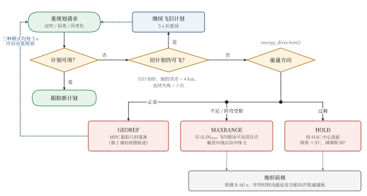

**图 10**　重规划失败时的决策流程。

---

## 第 7 课 电传飞控

> 代码：`sim/fcs.py`（50 Hz）

制导只给出 $`(\alpha, \phi, \delta_{sb})`$，换成舵面偏角是飞控的事。这里用时间尺度分离的非线性动态逆（图 11）：

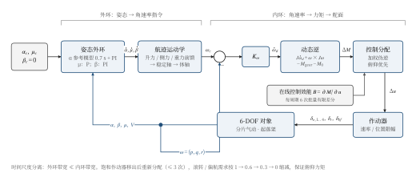

**图 11**　电传飞控结构。外环把姿态指令换成角速率指令，内环用动态逆算出所需力矩，再由在线控制效能矩阵分配到舵面。

**(1) 姿态外环 → 体轴角速率指令。** 迎角先经过一个参考模型（一阶，时间常数 0.7 s，速率限制 4°/s），再加 PI 修正，得到 $`\dot\alpha`$；
航迹滚转角 $`\mu`$ 用 P 控制得到 $`\dot\mu`$；侧滑角用 PI 控制。然后用精确的航迹运动学换算成稳定轴角速率，其中包括升力、侧力、重力前馈和转弯协调：

```math
\begin{aligned}
p_s &= \cos\beta\Big[\dot\mu - \frac{L}{mV}(\tan\gamma\sin\mu + \tan\beta) + \frac{g}{V}\cos\gamma\cos\mu\tan\beta\Big] \\
r_s &= \frac{Y + mg\cos\gamma\sin\mu}{mV} - \dot\beta \\
q &= \dot\alpha + \tan\beta\,p_s + \frac{L - mg\cos\gamma\cos\mu}{mV\cos\beta}
\end{aligned}
\qquad
\begin{aligned}
p &= p_s\cos\alpha - r_s\sin\alpha \\
r &= p_s\sin\alpha + r_s\cos\alpha
\end{aligned}
```

最后一步换算到稳定轴，是因为滚转要绕速度矢量进行。迎角 15° 时如果绕机体 x 轴滚，迎角会转成侧滑。

**(2) 角速率内环 → 所需力矩。** 期望角加速度 $`\dot\omega_d = K_\omega(\omega_\text{cmd} - \omega)`$，$`K_\omega = (2.6, 2.4, 2.2)`$，并限制在可用权限的 40% 以内。所需力矩为

```math
M_\text{req} = J\dot\omega_d + \omega \times J\omega - M_\text{gear}, \qquad \Delta M = M_\text{req} - M_0(u_\text{act})
```

$`J`$ 是完整的惯量张量，包括 $`I_{xz}`$。$`M_0`$ 是在当前舵面位置上计算的气动力矩。

**(3) 控制分配。** 控制效能矩阵 $`B = \partial M/\partial u`$（3×5：4 片升降副翼 + 方向舵）**在线**获得：
每个飞控周期用完整的分片气动模型做 6 次批量求值，按有限差分计算。然后求加权、正则化的伪逆，并向偏好分布（同侧内外升降副翼相等，方向舵居中）靠拢：

```math
\Delta u = d + W B^\top\big(B W B^\top + \lambda I\big)^{-1}(\Delta M - B d), \qquad d = u_\text{pref} - u_\text{act}
```

计算前按 $`\bar q S\cdot(b, \bar c, b)`$ 对力矩做归一化。饱和的作动器从求解中移除，剩余的需求重新分配，最多迭代 3 次。
**俯仰优先**：如果滚转和偏航的需求会导致饱和，就按 1 → 0.6 → 0.3 → 0 的比例缩小这两个轴的需求，保证俯仰力矩不受影响。
角速率限制也随剩余可达力矩自适应：沿伪逆方向，按剩余行程估算各轴、各方向的最大角加速度，从而得到速率上限。

**(4) 其他。** 体襟翼自动配平：缓慢地把对称升降副翼卸载到目标值（巡航 −1°，着陆构型 +3°）。
作动器模型为一阶滞后 + 速率限制 + 位置限制：升降副翼 −33°/+18°、20°/s；方向舵 ±27.1°；减速板 0–98.6°、6.1°/s。
迎角包线保护（只在 AUTO 下）：制导的迎角指令限制在可配平、并为副翼和方向舵保留余量的上限内（跨声速和低超声速时最低）；手动 CSS 不限制。

---

## 课后思考题

1. 在 3.4 中，如果去掉虚拟控制 $`\nu`$，从一个能量明显过剩的出生点做冷启动，你认为第一轮子问题会出现什么情况？试着修改 `w_nu` 做实验。
2. 3.6 的日志中，$`t_f`$ 随迭代单调增加。如果把 $`w_{\Delta u}`$ 调小 10 倍，$`t_f`$ 会怎样变化？为什么？
3. MPC 的能量项 $`e_k = (0,0,1,V^r/g,0,0)`$ 是 $`E_h`$ 的一阶近似。在什么情况下这个近似会明显失准？
4. 4.2 说按时间跟踪会让滑翔机“追时间表”。请构造一个持续逆风的场景，比较空间重索引与时间索引两种做法的能量损失。
5. 5.4 中，如果把 $`h_\text{off}`$ 改成 0，拉平曲线会变成什么样？接地时间和接地点会怎样变化？
6. 为什么 A/L 的纵向用经典着陆律而不用 MPC？试把 MPC 的步长改成 0.25 s、时域保持 28 s（`Mpc(model, K=112, dt=0.25)`），观察对拉起圆弧的跟踪效果和 QP 的求解时间。
7. 第 2 课的能量估计用了 $`\sqrt{\cos\phi}`$ 而不是 $`\cos\phi`$。写一个小脚本，在一组出生状态上分别用两种写法调用 `select_plan`，再用 SCP 是否到达 ALI 作为“真值”，比较两者的可达性误判率。

---

# 仿真的逼真程度

> 各子系统建模到什么程度，哪里做了简化。

## 飞行动力学（`sim/dynamics.py`、`sim/simulator.py`）

- **6-DOF 刚体**：四元数姿态，完整惯量张量（$`I_{xx} = 1.30\times10^6`$，$`I_{yy} = 9.38\times10^6`$，$`I_{zz} = 9.65\times10^6`$，$`I_{xz} = 2.25\times10^5`$ kg·m²），质量 99.8 t。
- **积分**：RK4，物理步长 0.01 s（100 Hz）；靠近地面或轮子着地时，细分为 4 个子步（400 Hz），用于计算起落架的刚性接触。
- **时序**：飞控 50 Hz，制导 10 Hz，MPC 2.5 Hz，作动器在每个物理子步更新。
- **地球模型**：平面地球。地球曲率只在画面中体现。重力随高度按平方反比变化。

## 空气动力学（`sim/aero.py`）

气动不查整机表，而是部件叠加：每一步按各单元的当地来流（机体相对气流、$`\omega\times r`$ 和阵风）算力。

- **升力面条带**：左右机翼各 32 条（含翼套和机身穿越段）、体襟翼、垂尾。
  - 简单后掠分解：只用垂直于条带展向的速度分量计算力；
  - 亚声速时取 3/4 弦长处的当地来流，超声速时过渡到 1/2 弦长；力作用在当地气动中心，从 0.25c 移到 0.5c；
  - 升力线斜率：亚声速用 DATCOM，超声速用三角翼线性理论（区分亚声速和超声速前缘，含椭圆积分），跨声速平滑过渡；
  - 法向力/轴向力写法在任意迎角下都有效：位势项加部分前缘吸力，Polhamus 涡升力，涡破裂和失速衰减，接近 90° 时变为平板特性。
- **舵面**：4 片升降副翼、体襟翼、方向舵。亚声速用薄翼理论的襟翼效率 $`\tau(c_f)`$ 和 $`c_m`$ 增量，超声速用 Ackeret 理论的舵面载荷；
  大偏角时效率下降，并计算偏转阻力和铰链力矩。方向舵/减速板做成两块向外张开的分裂式面板。
- **型阻**：湍流摩擦（当地雷诺数，计入压缩性和防热瓦粗糙度）乘以形状因子，加上跨声速阻力发散和超声速波阻。
- **机身 + OMS 吊舱**：28 段细长体，Munk 附加质量力（垂直和侧向分开计算），Allen–Perkins 粘性横流，前体波阻，随 Mach 变化的底部阻力。
- **地面效应**：按每个条带的离地高度计算，包括 Wieselsberger 诱导阻力减小、升力线斜率增加和气动中心后移。
- **其他**：大迎角和高 Mach 时垂尾的侧洗与机身遮蔽；起落架阻力随放下程度变化；减速伞。
- `evaluate` 支持一次传入 $`K`$ 组舵面偏角，飞控用它在一次调用里完成有限差分。

**标定结果**（重心 $`x=0`$，起落架收起，减速板关闭）：

| Mach | $`C_{L\alpha}`$ /° | 静稳定裕度 | $`(L/D)_\text{max}`$ | $`C_{m\delta_e}`$ /° |
|---|---|---|---|---|
| 0.3 | 0.050 | +0.8 % | 4.87 | −0.0055 |
| 0.6 | 0.052 | +1.6 % | 4.98 | −0.0058 |
| 1.5 | 0.038 | +12.8 % | 2.26 | −0.0031 |
| 2.5 | 0.025 | ≈+1 % | 2.21 | −0.0015 |

增量：减速板全开 $`\Delta C_D \approx +0.079`$，起落架放下 $`\Delta C_D \approx +0.017`$。完整表格用 `python tools/aero_report.py` 打印。

**简化**：没有气动弹性，没有非定常气动（除附加质量项外），不考虑高超声速段（出生点 Mach ≤ 2.6）。系数是按公开资料“调到像 Orbiter”，不是风洞数据。

## 起落架（`sim/gear.py`）

每个轮子都是沿机体 z 轴的油气减震支柱：渐进弹簧，非对称阻尼（压缩和回弹不同），带触底。轮胎法向力、滚动阻力、带简单防滑的刹车
（摩擦力限制在峰值）、tanh 饱和的侧偏力、摩擦圆、前轮转向。
静态载荷分配：前轮约 20%，两个主轮各约 40%。按当前几何，擦尾角约 10.9°（真实 Orbiter 约 15°）。

**湿跑道与滑水**：前端把地面湿度换算成跑道水膜厚度（湿度 1 约 3 mm）发给仿真。轮胎可用摩擦系数：
- 干跑道峰值 0.85；有水膜时用 14 CFR 25.109(c)(1) 的湿跑道最大刹车系数曲线（随地速下降，按胎压插值），从干到湿随水膜厚度过渡；
- 积水超过胎纹和道面纹理的排水能力（约 1–3 mm）时发生动态滑水：水楔承担的载荷份额约为 $`(V/V_p)^2`$，
  $`V_p = 9\sqrt{p}`$ kt（主轮 315 psi 约 160 kt），这部分载荷没有摩擦力，刹车和转向一起丢失；
- 刹车力 = min(刹车力矩，防滑效率 0.8 × 可用摩擦)，侧偏力和摩擦圆按可用摩擦缩放；
- 排水阻力：每个轮胎 $`\tfrac12\rho V^2 C_D h b`$，$`C_D = 0.75`$，超过 $`V_p`$ 后轮胎浮在水上，阻力减小（EASA CS-25 AMC 25.1591）。

只刹车、不放减速伞，从 95 m/s 接地：干跑道 1740 m 停住，1 mm 水膜 2942 m，3 mm 积水 4402 m（4572 m 长的跑道几乎冲出，
滑水时还因丢失转向偏离中线约 9 m）。开始滑水和滑水结束都会给出提示，飞行数据面板显示跑道积水和主轮摩擦系数。
跑道按无刻槽的光滑道面处理（偏保守）。

**结构触地**：体襟翼后缘、下方两个喷管、机腹、机头下方和两侧翼尖（后缘与 25% 弦处下表面）是带库仑滑动摩擦的罚函数接触点。
翼尖不是刚性点：外翼的弯曲刚度和触地刚度串联，超过翼尖盒段的压溃载荷（约 250 kN）后塑性变形，接触力饱和，接触点向机翼内退
（压溃量），滑动时还按 Archard 磨损定律被磨掉（混凝土骨料对铝结构的两体磨粒磨损）。所以翼尖擦地只是损伤，飞机带伤滑跑；
只有外翼压溃加磨损超过 1.2 m，或者侧翻到滚转角超过 50° 才判坠毁；翼尖重重砸地本身不会折断机翼，只会压溃翼尖、计入损伤深度。刚性结构（擦尾、喷管）
仍按下沉率超过 3 m/s 判坠毁，机头触地或收着起落架触地直接坠毁。每次接触的摩擦功、法向力、滑动速度和接触点随状态消息发给前端。

**坠毁之后**：仿真不冻结，物理继续算。制导和飞控关闭，舵面停在坠毁时的位置，不刹车、不转向；主起落架因下沉率过大
压垮时起落架不再承载（显示为收起），机体落到机腹上滑行。残骸在结构接触点上滑动、翻滚直到停住，火花和尘土照常产生。
为了让翻过来的残骸不陷进地里，机体上部也有接触点（乘员舱顶、货舱门、OMS 吊舱、机身两侧、垂尾翼尖和根部），
只在坠毁后或滚转/俯仰超过 40° 时才参与计算，平时不增加开销。按 R 重新放置。

**火花**（`web/js/world/sparks.js`）：按摩擦功算磨下来的金属碎屑（翼尖是钛接头和钢紧固件，体襟翼加上 Inconel，喷管是钢），
粒径对数正态（中值约 0.15 mm），在接触面被闪温加热到接近熔点。每个颗粒单独积分：Cd(Re) 阻力（相对当地气流：风、尾流、
地效中的翼尖涡）、重力、在跑道上弹跳和滑擦；集总热容的对流（Ranz–Marshall）和辐射冷却；钛和钢在空气中点燃燃烧
（燃烧时间 ∝ d²），钢里的碳在燃尽时生成 CO 把液滴炸开，形成分叉的“星形”火花。亮度是该温度的黑体辐射（CIE 1931 → 线性 sRGB，
按场景的太阳照度标定），每个火花按快门时间画成能量守恒的运动拖影；快门随曝光自动变化（白天约 1/400 s，夜间约 1/60 s）。
整团火花作为一个点光源照亮跑道和机体。铝和隔热瓦磨成的粉尘进入轮胎烟的粒子系统。

**湿跑道水花**（`web/js/world/spray.js`）：水膜厚度由地面湿度给出（湿度 1 约 3 mm）。每个轮胎排开 ρhbV 的水，从印迹两侧
以接近轮速的速度、小仰角甩成水幕（双轮之间的两片内侧水幕相撞后向上形成中央水柱），胎面沟槽带起的水从轮胎后上方甩出（"公鸡尾"）。
接地瞬间轮胎还没转起来，在水膜上滑行，水幕更强；超过动态滑水速度 9√p kt 且水深足够时水幕更平更宽。拉格朗日液滴团：
水幕先以完整液膜飞出 0.4–1.2 m（几乎不受气动阻力）再撕裂成液滴；稠密水雾带着空气一起走（按质量载荷的双向耦合），
所以水幕能向两侧和上方冲出几米；Cd(Re) 阻力、We > 12 的二次破碎（在破碎时间内逐渐变细）、撞地合并或溅起（Mundo 判据）、
打到机翼下表面后沿表面流走、尾流和翼尖涡输运、湍流扩散（大液滴按 Stokes 数跟得慢）。
外观：粗水滴用启动时程序生成的"羽毛"精灵（沿运动方向的液滴条纹和散落水珠），雾化后渐变成丝缕状雾团，每个精灵都按
液滴团的消光截面归一化。光学厚度由液滴数和粒径算出，相函数含前向衍射峰、主虹（42°）和副虹、细雾的白色雾虹；
太阳光按飞机上方云层的遮挡衰减（与地面的云影同一算法），阴天天空光变灰变暗——暴雨中水雾是灰白色的，不会发光。

## 大气与风（`sim/atmosphere.py`、`sim/wind.py`）

- US1976 标准大气。
- 平均风：10 m 参考风速，500 m 以下 1/7 次幂律。
- 湍流：MIL-F-8785C 的 Dryden 形式，低空（< 1000 ft）和中高空（≥ 2000 ft）两套参数，中间线性混合，在机体轴生成。
- 自动天气：风速、风向和湍流按 Ornstein–Uhlenbeck 过程缓慢漂移。前端根据云场算出飞机所在位置的风暴强度并发给后端：
  积雨云内强湍流和上升气流，云下雨幡中下沉气流和阵风锋。垂直气流在 150 m 以下逐渐减弱。

## 航电与座舱显示（`web/js/ui/meds.js`、`hud.js`、`web/js/world/cockpit.js`）

显示器仿照轨道器 MEDS 玻璃座舱（2000–2011 年的 OV-103/104/105），符号、颜色、刷新节奏和交互方式都尽量照真实系统做。

- **MDU 硬件**：喷漆面板，带 Dzus 紧固件的边框，6 个边缘键，拨动开关（ADI ATTITUDE INRTL/LVLH/REF、ERROR、RATE、地图方向、电源），
  亮度和地图量程旋钮（5–160 NM 六挡），带按键音；开机先跑自检（背光、LCD 初始化、BITE）。窗口可以拖动、缩放、折叠，位置保存在 localStorage。
- **边缘键菜单**：MAIN MENU → FLT INST / SUBSYS STATUS / DPS / MEDS MAINT，每台 MDU 都能切换到任意页面。
- **A/E PFD**：ADI 八球（逐像素着色的球体，带速率刻度，品红色误差针来自制导指令）；α、M/VR（低于 Mach 0.9 改为 KEAS）、H（5000 ft 以下改用雷达高度）、Ḣ 四条带式表；
  Nz 加速度表；HSI；下滑道指示；TAEM/A-L 模式通告；STALL / OVERSPEED 告警（见下）。
- **包线告警**（`sim/envelope.py`，25 Hz）：失速和超速是两个互相独立的量，所以可以同时报警。
  - **超速**按当量空速（即动压、结构载荷）判断：收起落架时 VMO = 350 KEAS（19.9 kPa，比制导最快的外下滑道速度高 10 kt），
    起落架未收起时 VLE = 300 KEAS（座舱标牌 GEAR DN NOT ABOVE 300 KEAS）。
  - **失速**不是速度门限，而是机翼的流动状态：机翼越过最大升力点，迎角再增加升力反而下降（$`dL/d\alpha \le 0`$）。
    用 `sim/aero.py` 的片条模型在当前的当地气流里（含滚转/俯仰角速度、侧滑、升降副翼偏度、阵风和上升气流、地效）
    分别计算左右半翼在 $`\alpha`$、$`\alpha\pm1°`$ 的升力，得到斜率和曲率；牛顿步 $`-L'/L''`$ 加一次割线修正给出离最大升力点还差多少度迎角。
    任一半翼斜率 ≤ 0 时报红色 **STALL**（只有一侧时显示 STALL L / R，即翼尖下坠的非对称失速），差不到 3° 时显示琥珀色 **α MARGIN**。
    所以失速迎角随舵面和机动变化：升降副翼后缘上偏 −33° 时外翼段推迟分离，实测失速迎角约 34°，而舵面归零的静态升力曲线峰值在 28.5°。
  - PFD 上：ADI 中部的告警框（STALL 一直闪烁，OVERSPEED 前 5 s 闪烁），α 带式表上从当前最大升力迎角起的红色斜纹带和其下 3° 的琥珀带；
    速度带上方是 VMO/VLE 红色斜纹带，下方是当前过载下的失速速度 $`V_s(n)=\sqrt{2nW/(\rho_0 S C_{L\max}(M))}`$
    （仅作参考，告警不看它）。拉大过载时两条带会合拢（"棺材角"）。告警同时触发主告警灯（无音响）。
  - 告警在主轮或前轮触地、动压低于 300 Pa 时抑制。
  - AUTO 下飞控始终把迎角限制在可配平且留有滚转/偏航余量的上限内（约 20°），正常进近不会触发任何告警（种子 1000、1、2 实测最小失速余量 > 30°，
    最大 292 KEAS，放起落架时 269 KEAS）。手动 CSS 没有迎角保护，满拉杆可以拉到 40°，把机翼拉到失速。
    注意：飞控俯仰角速度限制在 8°/s，从 VMO 以上拉杆时速度会先掉下去，迎角才到最大升力点，所以"一边超速一边失速"在自由飞行中很难飞出来，
    自检里是直接把状态放到 360 KEAS、α 29° 来验证的（约 7 g 的加速失速）。
- **HSIT**（SPEC 50 HORIZ SIT 与 MEDS HSI 的符号）：
  - 20/40/60 s 等坡度预测圈，按 FSSR 的转弯率 $`g\tan\phi/V_g`$ 计算；
  - 品红色 HAC 圆，带转弯方向箭头；跑道按比例绘制；SCP 规划显示为品红色虚线；HAC 切换后旧 HAC 保留 60 s；
  - H/C/R 方位指针，顶部标尺和右侧标尺随阶段切换（到 HAC 的时间、HAC 径向误差、跑道侧偏、高度误差）；
  - 读数：GS、TAS、KEAS、M、风、顶风/侧风分量、经 HAC 到接地点的距离、ΔAZ/HTA/ΔY、TTG、ΔE（能量走廊 +8000/−4000 ft）、减速板实际值和指令值；DPS 状态字符 ↑ ↓ M；
  - 颜色按 NASA 座舱升级颜色表和 FAA AC 25-11B；信息行按优先级排序，新信息先反色闪烁 5 s。
- **显示处理器的时序模型**：模拟 1980 年代 GPC 的节奏。
  - 每 480 ms 采样一次导航状态，160 ms 后才上屏，所以画面一格一格地跳，并且有延迟；
  - 慢变量（目标、方位、风、能量、所有数字读数）按 960 ms 周期计算；
  - 改变地图量程后，地图区先空白，等下一个数据周期和坐标变换完成；
  - 3 s 没有数据时，整屏画大 X，并显示 POLL FAIL。
- **其他页面**：SPI 舵面位置指示；VERT SIT、HORIZ SIT、GNC SUMM 三个 DPS 风格的 51×26 字符页面，1 Hz 刷新，底行显示故障信息。
- **字体**：不用系统字体。所有文字都是矢量笔画字体（8×12 网格，圆头笔划，只有大写），和符号用同一支“笔”画出来。
- **告警**：主告警灯只在出故障时闪烁。
  - 状态类（能量不足、降级模式）：条件消失后自动熄灭；
  - 锁存类（坠毁、擦尾、重着陆、冲出跑道）：保持到人工确认。
  - C&W 告警矩阵 40 盏灯中只有 GPC 一盏会亮，其余子系统不模拟故障。
- **HUD**：按 SCOM 进近着陆格式绘制，只显示在组合镜范围内，并且是准直的。内容包括速度矢量、制导菱形、KEAS 和高度带、俯仰刻度、跑道轮廓、拉平三角、Nz 和减速板指令。
  带式表用临界阻尼低通平滑，数字窗按 5 Hz 采样保持。

**简化**：只模拟 GNC 相关的显示内容。其他子系统（APU、液压、电源等）的页面和开关是静态的。DPS 页面的内容是按真实格式排版的仿真数据，不是真实的飞行软件。

## 3D 座舱（`web/js/world/cockpit.js`）

- **布局**：完整封闭的前飞行甲板。视点在指令长眼位：距 MDU 面板约 30 in，面板后倾 15°。
  有六块前窗 W1–W6 和两块顶窗，遮光罩，F2–F8、C2/C3、L1/L2、R1/R2、O1–O9 各面板，九台 MDU 显示实时画面，还有座椅、驾驶杆、脚蹬。
- **渲染方式**：座舱在以机体为原点的独立场景中渲染，避免 float32 精度不足导致舱内阴影闪烁。
  阳光只从舷窗射入；天空光按形状因子和体素遮挡烘焙。
- **舷窗雨水**：逐滴做物理模拟。
  - 雨滴谱为 Marshall–Palmer 分布，撞击时按 $`K = We^{1/2}Re^{1/4}`$ 判断是否溅射；
  - 水滴受重力、表面气流拖曳和接触线钉扎力作用；
  - 渲染时视线按斯涅尔定律和菲涅尔公式穿过玻璃 → 水 → 空气。
- **头部运动**：用眼位比力（质心过载加上 $`\dot\omega\times r + \omega\times(\omega\times r)`$）驱动三个轴的阻尼弹簧，另外叠加抖振、湍流和跑道颠簸。

## 气动声学：滑翔时的风声（`web/js/world/aeroacoustics.js`）

轨道器没有发动机，滑翔时听到的只有气流本身。风声不用录音或预设音色：每帧从飞行状态（真空速、Mach、
当地大气、风和阵风、各舵面偏角、起落架位置、姿态和轨迹）算出听者处每个 1/3 倍频程（20 Hz–20 kHz，31 个频带）
的均方声压（Pa²），再由 AudioWorklet 合成出谱完全相同的高斯噪声。

**座舱里**：前机身湍流边界层的壁面压力脉动，透过舱壁传进乘员舱。

- **壁面压力谱**：Goody（2004）谱形；边界层按距机头的流程长度当平板计算（Schultz-Grunow 当地摩擦系数，
  Eckert 参考温度修正压缩性，绝热壁，防热瓦粗糙度系数与 `sim/aero.py` 相同）。
  量级用内变量标度 $`(p_\mathrm{rms}/\tau_w)^2 = 6.5 + 1.86\ln(Re_\tau/333)`$（Farabee & Casarella 1991），
  与 Lowson 的飞行关联式 $`p_\mathrm{rms}/q = 0.006/(1+0.14M^2)`$ 相差 1–4 dB。
- **舱壁传声**：按真实层次写成斜入射平面波传递矩阵，再在 0–78° 上做扩散场平均：外蒙皮加防热瓦、前机身与乘员舱之间的
  夹层（向外界通气，所以夹层空气是外界的气压；部分填充隔热毯，用 Delany–Bazley 模型）、乘员舱壁；舷窗是热防护窗、
  通气夹层和承压窗。每块板都有面密度、弯曲刚度（因此有吻合效应）、板的基频和损耗因子。高空空气稀薄，夹层的“空气弹簧”
  变软，质量–空气–质量共振移到低频，通过夹层的空气声几乎传不过来。剩下的是乘员舱安装点的结构声，
  用 Sharp 点连接模型计算（两层板合成质量定律，再加 $`20\lg(e f_c) + 20\lg\frac{m_1}{m_1+m_2} - 45`$ dB）。
- **舱内声场**：混响声场 $`4W/R`$（房间常数由随频率上升的吸声系数算出），加上眼睛旁边前风挡的直达声。
- 下面这些机体噪声源（座舱正下方的前起落架、升降副翼、远在尾部的减速板）也经同一套舱壁传进来。
  超声速飞行时，后方的声音追不上座舱。

**座舱外**（追随、塔台、跑道、掠过相机）：听到的是机体向远场辐射的噪声。

- **声源**：Fink（1977）机体噪声方法，用 ANOPP 的无量纲写法
  $`p^2 = \rho^2c^4\,\Pi^*\,D(\theta,\phi)\,F(S)\,/\,[4\pi r^2(1-M\cos\theta)^4]`$。
  部件包括：机翼、垂尾和体襟翼后缘（$`\Pi^* \propto M^5\delta b`$，$`\delta`$ 为后缘处的湍流边界层厚度）；
  偏转的升降副翼、体襟翼，以及向两侧张开的方向舵/减速板两片面板，都按后缘襟翼处理（$`\propto M^6 S_f\sin^2\delta`$，偶极子垂直于偏转后的表面）；
  起落架机轮（$`\propto M^6 N d^2`$）和支柱，按放出程度缩放。
  每个谱函数 $`F(S)`$ 对 1/3 倍频程求和都等于 1，自检会核对这一点。
  ANOPP 指向性里的精确零点（后缘正后方或在自身平面内、偶极子侧向）属于理想化声源：无限薄半平面、紧致偶极子。
  真实的边缘有弦长、厚度、后掠和上反角，尾流会折射声音，声源分布在几米范围内，而且关联式只在约 30°–150° 的飞越角度上拟合过。
  所以每个指向性 $`f`$（球面平均为 $`m`$）取 $`(1-\varepsilon)f + \varepsilon m`$，$`\varepsilon = 0.1`$：零点约比平均低 10 dB，总辐射功率不变。
- **传播**：在记录下来的飞行轨迹上解推迟时间。此刻听到的声音，是飞机过去某一时刻在当时位置发出的，所以塔台处的轰鸣要等飞机飞过以后才到。
  计入风对声传播的搬运、声源和听者运动造成的多普勒频移、对流放大（取 Ffowcs Williams 有限相干时间形式，在马赫锥上有界）、
  超声速时的两个发声点或无发声点（马赫锥外完全无声；每个部件各有自己的马赫锥，37 m 长的机体扫过时声音渐入渐出，而不是突然开关）、球面扩散、沿斜程积分的 ISO 9613-1 空气吸收（湿度随高度递减，空气越稀薄吸收越强）、
  地面反射（Delany–Bazley 地面阻抗，平面波反射系数，干涉在频带内平均）、上折射声影区，以及声源到听者的 $`\rho c`$ 阻抗变化。
- **回放**：听者处 1 Pa（94 dB SPL）对应 −26 dBFS（有效值）。95 dB SPL 以下按物理声级原样播放，座舱和远处飞过之间保留真实的响度差；
  95 dB 以上用 2:1 软拐点（宽 10 dB）压缩，作用类似画面的曝光映射：把 110–120 dB 的近距离掠过压到扬声器和耳朵能承受的范围。
  例如追随相机在 M0.9、打开减速板时绕机一周，物理声级 97–112 dB，播放为 96–104 dB。

由模型算出的典型声级（`node tools/aeroacoustic_selftest.mjs` 打印）：

| 工况 | 总声级 | A 计权 |
|---|---|---|
| 座舱，TAEM，Mach 2.5 / 25 km | 73 dB | 67 dBA |
| 座舱，Mach 0.9 / 11 km | 83 dB | 74 dBA |
| 座舱，进近 155 m/s / 3 km，减速板 60° | 91 dB | 79 dBA |
| 座舱，135 m/s / 100 m，放起落架 | 95 dB | 82 dBA |
| 后方 75 m 追随相机，155 m/s | 81 dB | 74 dBA |
| 正下方地面，135 m/s 在 100 m 高掠过，放起落架 | 103 dB | 99 dBA |
| 塔台，侧向 3 km，155 m/s / 600 m | 56 dB | 49 dBA |

**合成**（`web/js/world/aero_synth.js`，在 AudioWorklet 里运行；不支持时改用 ScriptProcessorNode）：1/3 倍频程滤波器组。
每个频带用独立的白高斯噪声，经 6 阶 Butterworth 带通滤波；输入增益按滤波器的实际噪声带宽（$`|H|^2`$ 的积分）设定。
响的频带的裙边会漏进安静的相邻频带，比如座舱里的共振峰比相邻频带高 18 dB；用泄漏矩阵和非负 Richardson–Lucy 迭代反解各滤波器的功率，使每个 1/3 倍频程内的功率等于模型值。
每收到一份新频谱，就在 dB 域里沿直线滑到新值，滑动时长等于实测的消息间隔（即页面的帧时间），并逐样本插值：
任何帧率下都没有台阶（自检模拟 30 fps，每个 128 样本块的声级都在变化）。除滤波器本身的群延迟（1 kHz 处几毫秒）外，延迟只有一帧，自检中 60 fps 时声级变化约 20 ms 后到位。
两耳按球形人头（半径 8.75 cm）计算：直达声到达远侧耳朵的时间差按 Woodworth 公式 $`(a/c)(\varphi+\sin\varphi)`$ 计算（最大 0.66 ms），
声级差用 Brown & Duda（1998）的头影滤波器计算，低频几乎为 0，高频可达约 16 dB；以正前方声源为 0 dB 基准。座舱里风挡的直达声随转头改变方向；扩散声两耳各用独立噪声。
听者是装在相机平台上的麦克风：追随、座舱、俯瞰相机随轨道器一起运动（转视角不算穿过空气的运动），塔台、跑道、掠过相机固定在地面，自由相机按实际移动计算多普勒。
自检核对：各频带与模型的偏差在统计误差内（平直谱 ≤ 0.4 dB，陡峭的座舱谱 ≤ 1.3 dB），两耳的声级差和时间差与模型一致，直达声两耳完全相关、扩散声不相关，每次音频回调耗时约 0.1–0.5 ms（预算 2.67 ms）。

简化：湍流边界层被当作等效扩散声场来激励舱壁，没有解析它的对流波数结构；风挡处用自由流条件，不算机头上的局部加速，
Mach 1 以上也不算激波层；Fink 关联式来自常规亚声速运输机，Mach 0.8 以上把功率和 Strouhal 标度固定在 0.8；没有模拟音爆。

## 气流可视化（`web/js/world/airflow.js`、`airflow_section.js`、`airflow_wake.js`、`airflow_paint.js`）

按 `V` 打开。输入都来自 `sim/aero.py`：aero 消息每秒 20 次，带上每条条带的环量、法向力分项、附着比例和当地动压比
（`AeroModel._detail`）。流场按慢动作计算：来流取“慢放速度”（默认 15 m/s），诱导速度和机体转动按同一比例缩小。

**表面压力**：机体表面按压力系数 $`C_p`$ 着色，每 0.2 一条等压线。

- 升力面：条带法向力分四项（迎角产生的位势项、舵面项、Polhamus 涡升力项、分离项），各按自己的弦向分布铺开：
  亚声速是平板 $`\sqrt{(1-x)/x}`$ 和薄翼理论的襟翼载荷，超声速是 Ackeret 均布，涡升力集中在前缘后面，分离项均布。
  每种分布都归一化，上下表面的压差积分回去等于模型的条带力；机翼上两者相差约 5 %。
  表面速度由条带当地来流加涡层强度的一半得到，另有厚度项（只在亚声速）、Riegels 前缘修正，
  以及展向环量梯度诱导的展向流；$`C_p = 1-(V/U)^2`$。
- 机身和 OMS 吊舱：细长体椭圆截面上的势流横流，加厚度源的轴向流；横流大时背风面按分离处理。底部用模型的底部压力系数。

**机翼剖面**：切开靠近相机一侧的外翼，在剖面上逐帧推进一个二维非定常涡方法（LDVM，Ramesh 等 2014）：

- 翼型取自模型网格，升降副翼按当前偏角转动；中弧线上是附着涡层（Fourier 级数），厚度用源分布表示。
- 每一步按 Kelvin 定理从后缘放出一个涡；前缘吸力参数超过临界值时，前缘也放涡，把它压回临界值。
  临界值由模型这条条带的附着比例决定：模型说附着，就不脱前缘涡；模型说失速，前缘就持续脱涡。
- 所有自由涡按当地速度移动（来流、附着涡层、厚度源和其他涡），涡核随时间变粗，旧涡的环量慢慢衰减，靠近的同号涡合并。
- 剖面的来流是模型在该处的当地来流（含机体转动），再扣除模型机翼自身的下洗：按升力线理论
  $`\alpha_i = C_L\,(1/a - 1/2\pi)`$，$`a`$ 是模型这条条带的三维升力线斜率（消息里的 `as`，按后掠换算到顺流方向），
  $`C_L = C_N\cos\alpha`$。附着时直接取薄翼理论（含弯度和升降副翼）下法向力等于模型值的迎角，两者在线性段一致；
  再用一个慢积分把实时算出的法向力修正到模型值（最多 7°）。迎角过 90° 时 $`C_L`$ 变号，角度连续通过。
- 失速后二维剖面没有翼尖泄压，算出的法向力比模型的三维条带大（50° 左右约大一倍），图例里两条曲线会分开。
- 显示：上游烟耙放出的烟线和机头放出的染色都在 GPU 上按算出的速度场输运（半拉格朗日，Catmull–Rom 插值），
  底色是当地速度对应的压力，涡核显示为低压斑。
- 图例左边是过去 12 倍弦长时间里剖面的法向力系数（白，实时计算）和模型的值（蓝虚线），右边是弦向压差分布。

检查：平板在定常来流下的法向力等于 $`2\pi\sin\alpha\cos\alpha`$；迎角阶跃后的响应和 Wagner 函数一致；
分离时用压力积分和涡量冲量变化率算出的法向力互相吻合。

**尾涡**：所有条带的自由尾涡面。每条条带是一个涡环（四分之一弦线上的附着涡、到后缘的两条边），环量取 aero 消息里的条带环量。
每走 1.3 m 在后缘放下一排节点，它和上一排之间的涡环取放出时的条带环量；此后每帧，每个节点按所有附着涡和尾涡段的
Biot–Savart 诱导速度加来流和转动移动（涡核随时间变粗）。尾涡面因此自己在翼尖卷起，机动留下的变化也会沿尾流向后传。
节点存在 GPU 纹理里，每帧一次全量计算（46 列 × 40 排节点）。线条是从后缘拖出的涡线和每三排一条的时间线，
颜色表示尾随涡的旋转方向，尾涡面按它携带的环量显示深浅。

剖面和尾涡单独渲染成一层，合成时按飞机到相机的距离与云的平均深度比较，决定在云前还是云后。

**简化**：表面压力的弦向分布形状来自薄翼理论；机身不计机翼诱导的上洗；剖面按不可压流计算，跨声速以上只作参考；
二维剖面没有展向流，失速时的形态是二维的；尾涡不计机身和地面。

## 渲染

- **大气**：Hillaire 2020 方案的四张 LUT，逐像素计算空气透视。
- **体积云**：Perlin–Worley 噪声，Beer–Powder 散射和多次散射近似，时域重投影。
- **地形**：14 级几何裁剪图，CDLOD 形变消除接缝。
- **机场**：FAA 标线，进近灯，PAPI（包括 20° 外下滑道 PAPI）。
- **雷暴**：雨幡、闪电（含回击）、按声速延迟的雷声、地面积水的屏幕空间反射。
- **风声**：由气动声学模型实时计算，见“气动声学”一节。
- **气流**：表面压力、实时计算的机翼剖面流动和自由尾涡，见上一节。
- **机体**：材质为程序化的防热瓦，操纵面绕真实铰链轴转动。

---

# 测试与结果

```bash
python tools/sim_selftest.py                  # 6-DOF / 飞控自检
python tools/gnc_selftest.py                  # GNC 回归：多进程并行，同步规划器
python tools/gnc_selftest.py --wind --turb    # 有风和湍流
python tools/gnc_selftest.py --fault-scp 90   # 前 90 s 所有规划都失败，检验降级模式
python tools/readme_figures.py               # 重新生成 README 插图（另需 matplotlib；飞行数据缓存在 .cache/）
node tools/aeroacoustic_selftest.mjs          # 气动声学：对照参考值（ISO 9613、质量定律、Fink 归一化、推迟时间、马赫锥、合成器谱）
```

**成功标准**：在跑道入口之后接地，下沉率 < 3 m/s，偏离中线 < 20 m，并在跑道上停住。

最近一次全面测试结果如下。注意：这组测试是在 OGS 瞄准点为 2.3 km 时测的，改到 1.5 km 后还没有完整重测。

| 工况 | 成功率 | 接地下沉率（均值 / 最大） | 接地点（入口后） | 偏离中线 |
|---|---|---|---|---|
| 无风 ×40（RWY33 19 次，RWY15 21 次，含 Mach 2.4 / 24 km 出生） | 40/40 | 0.85 / 0.90 m/s，207 KGS | 575–581 m | 0.0 m |
| 10 m/s 风 + 中度湍流 ×12 | 12/12 | 1.26 / 1.88 m/s，182–223 KGS | 177–946 m | ≤ 4 m |
| 近场高能量出生（8/15/22 km × 15/20 km 高 × 3 个方位） | 18/18 | | | |
| 高速背向、直进过高等极端出生点 | 8/8 | | | |
| `--fault-scp 90` | 12/12 | | | |
| `--fault-scp 1500`（全程没有 SCP） | 9/10 | | | |

- **SCP**：平均 3.2–3.6 次迭代，约 180 ms（冷启动约 0.5 s），收敛率 98–100%。
- **MPC**：每次约 13 ms。
- **飞行包线**：全程最大动压 16.8 kPa，过载 0.4–2.1 g。

**典型着陆时间线**（无风，种子 1000）：

| 相对接地时间 | 事件 |
|---|---|
| −26 s | 主轮约 1550 ft 开始拉起，下沉率 53 m/s，292 KEAS |
| −14 s | 295 ft（90 m）放起落架 |
| −10 s | 约 120 ft 进入指数段 |
| −8 s | 70 ft 并入 IGS，下沉率 4.5 m/s |
| −6 s | 43 ft、233 KEAS 进入最终拉平 |
| −5 s | 过入口，主轮高 32 ft |
| 0 | 入口后 560 m 接地，下沉率 0.81 m/s（2.7 fps），208 KGS |

进入拉平后每秒的下沉率依次为 3.5 → 3.5 → 3.1 → 2.2 → 1.3 → 0.85 m/s，没有平飘，也没有反弹。

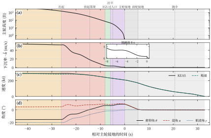

**图 12**　上表那次着陆的时间线（以主轮接地为 0）。(a) 主轮高度，对数坐标；(b) 下沉率，小图为接地前 8 s；
(c) 速度；(d) 俯仰角、迎角和航迹角。竖线标出关键事件，背景色为飞行阶段。

**WebSocket 消息**：`state.gnc`（阶段、能量误差、剩余航程、SCP/MPC 状态、基准指令）；`plan`（SCP 节点、HAC、ALI、进近折线）；`mpc`（预测轨迹）。
要自己画图分析，可以直接订阅这些消息。

---

# 代码结构

```
server.py              HTTP 静态服务 + WebSocket；实时仿真循环（时间倍率 0.25–8×）
sim/                   飞行仿真（Python，numpy 向量化）
  dynamics.py          6-DOF 刚体（四元数、完整惯量、RK4）
  aero.py              部件叠加气动（条带、舵面、细长体机身、地面效应、起落架、减速伞）
  fcs.py               电传飞控：α/β/μ 外环 + 非线性动态逆 + 在线控制效能 + 俯仰优先分配
  envelope.py          PFD 包线告警：超速（当量空速）与失速（片条模型算出的机翼升力曲线斜率）
  gear.py              起落架、轮胎、刹车防滑、前轮转向、结构接触
  trim.py              配平求解与配平表（α × Mach × 减速板 × 起落架）
  atmosphere.py wind.py  US1976；风廓线 + Dryden 湍流
  guidance.py          制导接口（注册表）+ 占位制导 hold_glide
  gnc/                 制导（讲义第 1–6 课）
    model.py           第 1 课：3-DOF 规划模型、配平表插值、流映射与雅可比
    geometry.py        第 2 课：跑道/HAC、Dubins、能量预算、方案选择、初值
    scp.py             第 3 课：自由终端时间 PTR 序列凸优化
    planner.py         第 3 课：规划前端（热启动、恢复、重选跑道、进程/Worker）
    mpc.py             第 4 课：LTV-MPC（凝聚 QP，OSQP / Clarabel）
    reference.py       第 4 课：稠密基准轨迹与空间投影
    approach.py        第 5 课：A/L 剖面、速度积分、着陆律、拉平律
    guidance_scpmpc.py 第 5–6 课：阶段状态机、降级模式
  spawn.py terrain.py  随机出生点、地形高度查询
  browser.py           浏览器版入口（Pyodide Worker）
worldgen/              程序化世界生成：地形侵蚀、海岸、河湖、地表覆盖、天气图
shared/                Python 与 JS 共用：orbiter_geometry.json（机体几何）、world.json
web/                   three.js r170 前端（已随仓库附带）
  js/render/           大气、体积云、地形、后处理
  js/world/            航天飞机模型、机场、座舱、天气、雨水、雷声、气动声学（风声）、气流可视化
  js/ui/               相机、HUD、MEDS 显示器、头部运动
  js/sim/              浏览器版：Pyodide 启动、仿真 Worker、规划 Worker
tools/                 自检、GNC 回归测试、气动报告、浏览器版构建与发布、README 插图（readme_figures.py）
docs/figures/          README 插图（SVG，由 tools/readme_figures.py 从仿真数据生成）
deploy/                在线演示的 nginx 配置和访问统计脚本
```

---

# 已知限制

- 本机上带 GNC 的仿真约为 2.5–3 倍实时，`hold_glide` 约 4 倍。
- `--spawn any` 的出生点有相当一部分能量不够飞回机场：GNC 会告警（LOW ENERGY），以 MAXRANGE 模式尽量接近机场，但多半会在场外坠地。
- Mach 2.4 以上、离场较远又背向机场的出生点仍可能失败。这个速度下升力只够约 1 g，转弯半径达几十公里，超声速倾侧速率只有 2–2.5°/s。
- 无头测试使用同步规划器，求解期间仿真时间不推进。实时服务中求解是异步的，冷启动的几秒延迟在测试中没有覆盖。
- 规划模型用配平后的 3-DOF 气动表，不含地面效应；A/L 段的俯仰由着陆律控制，不经过 MPC。
- 动力学按平面地球计算，不考虑高超声速段。
- 风声的舱体参数（蒙皮、夹层、窗层厚度、安装点间距）是根据公开资料估计的，不是实测值；没有模拟音爆。

---

# 参考文献

1. D. Malyuta, T. P. Reynolds, M. Szmuk, T. Lew, R. Bonalli, M. Pavone, B. Açıkmeşe. *Convex Optimization for Trajectory Generation: A Tutorial on Generating Dynamically Feasible Trajectories Reliably and Efficiently.* IEEE Control Systems Magazine, 42(5), 2022. ——SCP / PTR 入门建议先读这篇。
2. M. Szmuk, B. Açıkmeşe. *Successive Convexification for 6-DoF Mars Rocket Powered Landing with Free-Final-Time.* AIAA GNC Conference, 2018. ——时间伸缩与自由终端时间。
3. J. B. Rawlings, D. Q. Mayne, M. M. Diehl. *Model Predictive Control: Theory, Computation, and Design*, 2nd ed. Nob Hill, 2017.
4. B. Stellato, G. Banjac, P. Goulart, A. Bemporad, S. Boyd. *OSQP: An Operator Splitting Solver for Quadratic Programs.* Mathematical Programming Computation, 2020.
5. NASA JSC-23266. *Space Shuttle Approach, Landing, and Rollout Flight Procedures Handbook.*
6. T. E. Moore. *Space Shuttle Entry Terminal Area Energy Management.* NASA TM-104744, 1991.
7. S. Diamond, S. Boyd. *CVXPY: A Python-Embedded Modeling Language for Convex Optimization.* JMLR, 17(83), 2016.
8. P. J. Goulart, Y. Chen. *Clarabel: An Interior-Point Solver for Conic Programs with Quadratic Objectives.* arXiv, 2024.
9. S. Sieberling, Q. P. Chu, J. A. Mulder. *Robust Flight Control Using Incremental Nonlinear Dynamic Inversion and Angular Acceleration Prediction.* Journal of Guidance, Control, and Dynamics, 2010.
10. MIL-F-8785C. *Flying Qualities of Piloted Airplanes*, 1980. ——Dryden 湍流模型。
11. S. Hillaire. *A Scalable and Production Ready Sky and Atmosphere Rendering Technique.* EGSR, 2020.
12. M. Goody. *Empirical Spectral Model of Surface Pressure Fluctuations.* AIAA Journal, 42(9), 2004.
13. T. M. Farabee, M. J. Casarella. *Spectral Features of Wall Pressure Fluctuations Beneath Turbulent Boundary Layers.* Physics of Fluids A, 3(10), 1991.
14. M. V. Lowson. *Prediction of Boundary Layer Pressure Fluctuations.* AFFDL-TR-67-167, 1968.
15. M. R. Fink. *Airframe Noise Prediction Method.* FAA-RD-77-29, 1977；W. E. Zorumski. *Aircraft Noise Prediction Program Theoretical Manual.* NASA TM-83199, 1982.
16. ISO 9613-1:1993. *Acoustics — Attenuation of Sound during Propagation Outdoors — Part 1: Calculation of the Absorption of Sound by the Atmosphere.*
17. B. H. Sharp. *Prediction Methods for the Sound Transmission of Building Elements.* Noise Control Engineering, 11(2), 1978.
18. M. E. Delany, E. N. Bazley. *Acoustical Properties of Fibrous Absorbent Materials.* Applied Acoustics, 3(2), 1970.
19. J. E. Ffowcs Williams. *The Noise from Turbulence Convected at High Speed.* Phil. Trans. R. Soc. A, 255, 1963.
20. C. P. Brown, R. O. Duda. *A Structural Model for Binaural Sound Synthesis.* IEEE Trans. Speech and Audio Processing, 6(5), 1998.
21. R. S. Woodworth. *Experimental Psychology.* Holt, 1938. ——耳间时间差的球形人头公式。

---

# 许可证

本项目以 [Apache License 2.0](LICENSE) 发布，见 [`LICENSE`](LICENSE) 和 [`NOTICE`](NOTICE)。

第三方组件：

- `web/vendor/three/`：[three.js](https://threejs.org) r170，MIT 许可，原许可证见 `web/vendor/three/LICENSE`。
- 运行时依赖（不随仓库分发，通过 pip 或 CDN 获取）：NumPy、SciPy（BSD）；cvxpy、Clarabel、OSQP（Apache-2.0）；ECOS（GPL-3.0，仅作 SCP 的备用求解器，可不安装）；websockets（BSD）；Pyodide（MPL-2.0）。
  浏览器版构建（`tools/build_web.py`）会把 Pyodide 及其 wheel 复制到 `dist/` 中自托管，发布时请一并遵守它们的许可证。

欢迎提 issue 和 PR。讲义哪里没讲清楚，也请告诉我们。
